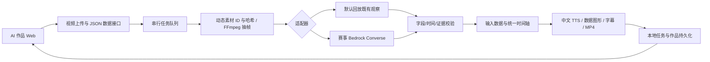

# COURTSIDE 工程设计 v3

2026-10-10 更新：视频＋NBA 数据→中文解说与数据图形 MP4→Web 播放/下载已在本地通过真实模型联调；操作、输入限制、调用费用和失败记录见 [AI_FILM_GUIDE.md](../../../docs/AI_FILM_GUIDE.md)。本轮只核验功能与产物，不检查布局/手机端。

2026-10-09 整理背景：此前工程基线为 2d0a16e，当前实现按本页顶部与[执行方案](../../../docs/PROJECT_PLAN.md)更新。[旧 v1 备份](../../../output/documentation-review-20261009/before/.kiro/specs/nba-deep-court-visualization/design.md)仅供追溯；其中伪代码、CloudFormation/YAML、价格小计和环境变量不能直接用于部署。

## 当前实际链路

| 模块 | 当前文件 / 职责 |
| --- | --- |
| Web | aws-nba/src/，四工作区、视频/证据联动、JSON 核验、Agent 面板 |
| 共享契约 | aws-nba/shared/agent.ts，内部请求/结果与任务类型 |
| 处理层 | aws-nba/agent/，HTTP、配置、队列、媒体、来源、校验和任务文件 |
| 模型层 | aws-nba/agent/providers.ts，fixture 或单次 Converse 多 JPEG 观察 |
| 官方适配 | aws-nba/agent/official-adapter.ts，官方协议未配置，明确拒绝冒充 |
| 基础设施 | aws-nba/infra/app.ts，仅本地 synth；实际部署尚未执行 |

技术栈为 TypeScript/Node、React/Vite、FFmpeg、AWS SDK v3 与 CDK，精确版本由 package-lock 锁定。旧 Python 编排、Lambda 查询/渲染、Hypothesis 性质测试是旧设想，不是当前实现或必要新增组件。

## 接口和状态

精确路由及启动步骤见[Agent 说明](../../../docs/AGENT_SKELETON.md)，避免重复维护接口表。核心包括 /ping、/api/health、/api/jobs 和同步 /invocations；后者仍是内部 schema，/official/invocations 当前返回 501。

输入支持样片与注册上传 UUID，拒绝路径/URL；四种 JSON 适配器转换明确单位，未对齐数据不烧录。成片最多 20 张稀疏证据帧、1–6 段解说，每条任务保存实际 PTS 和素材/图像/作品哈希。最多 4 条待处理/运行任务，串行，本地保留最多 200 条、历史最近 20 条；重启中断不重跑。

结果区分 fixture_replay 与 needs_review；interpretation 可为 null。模型只给观察文本、时间和证据 ID；官方 xFG 由已有目录独立关联。文本结构合规不证明观察真实。

## 数据契约

- 原片标注：内部 v0.2，毫秒；出手不确定区间不等于完整动作跨度。
- 前端回合导出：internal_review_not_contest_schema，只核验已收录回合；不得把输入 JSON 中任意地址加载成媒体。
- Agent：courtside.agent.request.v1 / .result.v1，以共享类型为准，秒；已收录预览资产。
- 正式比赛：等待官方 sample，单独适配，不用旧 v1 文档的自拟 AnalysisResult 当官方协议。

关联以组合 ID 为准；原值、定义、单位和来源分别保存。冲突字段进入隔离，绝不按文件 mtime 选取。经过明确公式得到的派生值可以使用，但必须标注，不谎称所有显示数值都直接来自原始 CSV。

## 模型与成本保护

当前赛事 nba/us-east-1，显式 fromIni，登录 SSO 自身区域 us-west-2；SDK 检查项目 ID，临时凭据只存内存并提前刷新。film 单次请求、2,400 输出 tokens、180 秒超时，不自动格式修复/重试；旧 analysis 保留 1,000 tokens。仓库默认 fixture，本机按授权开启 Bedrock；创建作品先检查 SDK 连接，失败不启动模型。真实单片成片已验收，双模型复核和独立语义质量未验证。

质量候选与历史价格场景见[当前方案](../../../docs/PROJECT_PLAN.md)和[10/08 预算](../../../NBA%E6%B7%B1%E5%BA%A6%E8%B5%9B%E5%9C%BA_%E6%80%BB%E4%BD%93%E9%A2%84%E7%AE%97%E4%B8%8E%E9%AB%98%E8%B4%A8%E9%87%8F%E6%A8%A1%E5%9E%8B%E9%80%89%E6%8B%A9_20261008.md)。$100 是建议预留，不存在 BUDGET_HARD_LIMIT_USD 自动拦截实现；单请求限制不等于项目总预算控制。正式调用前更新价格、可用性、区域路由及支出授权。

## CDK 与云接入缺口

现有模板固定赛事 us-east-1，包含两个私有、版本化、保留删除策略的 S3 bucket，CloudFront/OAC 和 HTTP AgentCore Runtime。执行角色 ARN 与同区 ARM64 ECR 镜像 digest 为必填外部参数；模板未建角色、未上传镜像/静态文件、未连鉴权 API。没有 Lambda，也不自动 bootstrap；部署仍需相应授权。

Dockerfile 有普通用户和 FFmpeg 配方，但未构建/启动验证；运行时模型访问尚缺 IAM role 凭据模式，不复制本地 profile 凭据进容器。云任务持久化、S3 读写、访问控制、Web 到 API 联通与正式权限边界仍待实现。

赛事环境与个人环境独立处理，取得对应授权和真实资料后再设计配置。先查 Portal 已有桶/角色/bootstrap，不能把当前准备模板的两新桶直接视作赛事部署方案。

## 接下来补哪一段

本地成片已完成真实上传、Sonnet 解说、中文音轨、字体/数据烧录、时间轴、Web 播放与下载。下一项为语义独立复核及官方 sample 适配。当前语音依赖 Windows Huihui，移入 Linux Runtime 前必须接入适用的语音/字体实现，不能原样宣称云端成功。

官方适配和新输入入口依 sample；真实模型依非零配额与调用授权；云联通依运行时、存储、鉴权和部署授权。详细验收见[执行方案](../../../docs/PROJECT_PLAN.md)及[质量协议](../../../%E5%87%86%E5%A4%87%E8%B5%84%E6%96%99/04_%E8%B4%A8%E9%87%8F%E9%AA%8C%E6%94%B6%E4%B8%8E%E5%AE%9E%E9%AA%8C%E8%AE%B0%E5%BD%95.md)。

历史 20 项验收见[AGENT_ACCEPTANCE.md](../../../docs/AGENT_ACCEPTANCE.md)；最新 31 项功能测试与真实模型成片见 [AI_FILM_GUIDE.md](../../../docs/AI_FILM_GUIDE.md)。本地检查和单片模型成功不代表公网、批量质量或正式赛事验收。
