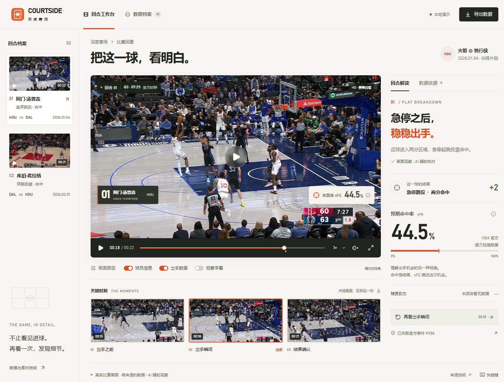

# COURTSIDE · 深度赛场

一个让真实比赛画面与有来源的数据相互连接的回合工作台。当前交付是**可交互的前端设计原型**：两段本地视频、两条已核对的出手事件，以及 41 条官方逐次投篮记录。



## 本地运行

环境：Node.js 24；已在 Windows、Node 24.19.0、npm 12.0.2 验证。

```bash
npm ci
npm run dev
```

打开终端显示的 `http://127.0.0.1:5173/`。没有云服务配置、API 密钥或环境变量前置要求。

```bash
npm run check
npm run build
npm run preview
```

`build` 输出到 `dist/`；当前未部署、未接入赛事 AgentCore / Portal。

## 已实现的流程

- 两段真实比赛片段切换，视频、解读、指标及来源同步更新。
- 原生视频播放/暂停、拖动进度、0.5/1/1.5/2 倍速、原声开关、全屏。
- 三个真实关键帧入口与已核对出手时刻的快速定位。
- 球员信息、逐次出手数据、AI 观察字幕三个独立图层。
- 回合解读 / 数据依据切换；来源弹窗保留官方记录链接与核对边界。
- 41 条投篮记录，支持球员、结果、关键字组合筛选与空结果状态。
- 手机端纵向投篮卡片、44px 视频控制、独立进度条；从档案回看时定位并聚焦视频。
- 视频加载状态、失败提示与重试恢复；全屏按钮和退出状态同步。
- 下载当前回合 JSON，或数据档案中的全部 41 条记录。导出的是数据，不是已渲染 MP4。
- 键盘操作、原生模态对话框、焦点返回、可见焦点、减弱动态效果和响应式布局。

## 设计交付

| 产物 | 文件 |
| --- | --- |
| 桌面整体设计图 | [desktop-review.jpg](docs/design/desktop-review.jpg) |
| 手机回看首屏 | [mobile-review.jpg](docs/design/mobile-review.jpg) |
| 手机解读与指标 | [mobile-inspector.jpg](docs/design/mobile-inspector.jpg) |
| 手机数据档案 | [mobile-archive.jpg](docs/design/mobile-archive.jpg) |
| 数据档案设计图 | [desktop-archive.jpg](docs/design/desktop-archive.jpg) |
| 来源弹窗设计图 | [source-dialog.jpg](docs/design/source-dialog.jpg) |
| 设计思路、视觉规则、信息架构 | [DESIGN.md](docs/DESIGN.md) |
| 自检、迭代记录与测试边界 | [QA.md](docs/QA.md) |
| 媒体副本来源、参数与哈希 | [media-manifest.json](docs/media-manifest.json) |

以上图片来自真实浏览器中的实际页面；不是静态图片伪装的交互页面。

## 数据与素材

| 素材 | 官方比赛 / 事件 | 官方时钟 | 视频出手约值 | 本次出手 xFG |
| --- | --- | --- | --- | --- |
| 阿门·汤普森 | 0022500491 / 396 | Q3 07:25 | 18.035 秒 | 44.5% |
| 库珀·弗拉格 | 0022500701 / 666 | Q4 01:34 | 16.800 秒 | 51% |

数据快照为 2026-10-09。来源：[Inside the Game](https://china.nba.cn/inside-the-game)、[阿门场次](https://china.nba.cn/game/0022500491)、[弗拉格场次](https://china.nba.cn/game/0022500701)。前端记录从已完成关联与校验的本地数据包提取，未调用付费模型。`src/data/shots.json` 是公开记录的字段投影；`src/data/clips.json` 是内部展示契约，不是赛事官方 schema。

2 次视频事件经 AI 视觉核对与官方事件交叉检查，尚未经过独立人工复核；其余 39 条没有本地视频关联。官方记账时钟、画面时钟、视频播放时间分别保存。未提供本回合引力或完整轨迹，界面不使用虚构数值或示例百分比填充。含义冲突的场次汇总没有进入前端。

媒体来自用户提供的两段训练视频。仓库只包含 1280×720、约 29.97 fps 的 H.264 预览副本，以及提取的 WebP 关键帧；AAC 原音轨重封装，无新生成语音。原文件未修改、未上传。媒体时间保留相同起点；降帧后的显示不应当作原始视频的逐帧精度测量。素材使用范围沿用原提供方授权，本仓库没有为赛事录像授予新的许可。

## 技术结构

React + TypeScript + Vite，原生 CSS 与 HTML Video；Lucide 图标。没有 UI 框架、外部字体请求、统计追踪或云端依赖。

```text
src/App.tsx          工作台、播放器、来源对话框、检索视图
src/data.ts          展示类型、时间格式、JSON 导出
src/data/            2 个视频条目与 41 条投篮记录
src/styles.css       色彩、排版、组件、响应式与动效规则
public/media/        本地视频预览和关键帧
docs/design/         实际页面设计图
```

范围仍限于前端设计与本地演示。未实现自动视频分析、轨迹追踪、TTS、带标注成片渲染、云部署、赛事重跑协议或平台提交。
