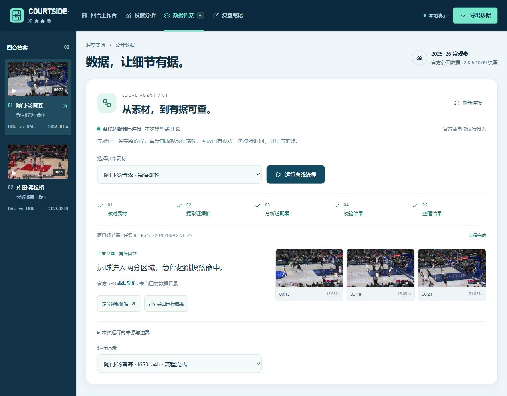
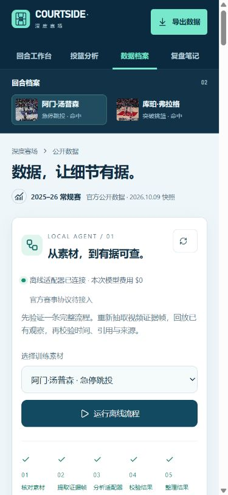
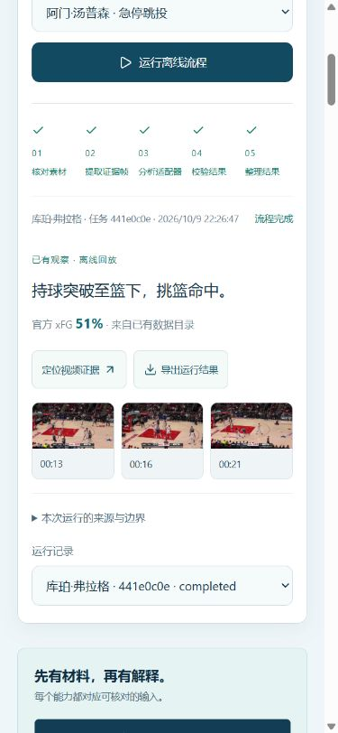

# Agent 骨架验收记录

日期：2026-10-09。环境：Windows、Node.js 24.19.0、npm 12.0.2。范围为本地 skeleton，不包含任何 AWS 资源部署或付费推理。

## 已通过

| 验证                                   | 结果                                                                                           |
| -------------------------------------- | ---------------------------------------------------------------------------------------------- |
| TypeScript 前端 + Agent + CDK 类型检查 | 通过                                                                                           |
| 自动化测试                             | 20/20 通过，其中 9 项 Agent 测试，11 项既有数据/复盘测试                                       |
| 真实视频处理                           | 阿门、弗拉格各成功解码 3 帧；JPEG 有效，帧 PTS 与请求位置误差 < 0.15 秒                        |
| 素材完整性与溯源                       | MP4 与媒体台账 SHA-256 匹配，原件/预览哈希分开，官方指标独立关联                               |
| 模型边界                               | 默认 fixture、0 模型调用；错误 profile/区域/跨区域模型 ID 被拒绝                               |
| 网页付费保护                           | 即使服务切成 Bedrock，`POST /api/jobs` 仍拒绝付费调用                                          |
| HTTP                                   | `/ping` 返回 Healthy；异步任务与同步 `/invocations` 均实际验证；未知协议、来源、超大输入被拒绝 |
| 失败与恢复                             | 失败保留错误码；重启不重跑未完成任务；4 个并发请求进入串行队列，第 5 个被拒绝                  |
| 前端联调                               | 两段素材运行成功；图片加载、JSON 下载、历史任务和刷新后恢复正常                                |
| 视频跳转                               | 弗拉格结果定位到 `flagg.mp4` 的 16.800133 秒                                                   |
| 服务断开/重连                          | 显示未连接与可操作提示，按钮禁用；重启后刷新恢复历史结果                                       |
| 响应式                                 | 360、390、768、1024、1440、1920 六档宽度，Agent 结果态没有页面横向溢出                         |
| 前端构建                               | 通过，JS 约 312 KB / gzip 95 KB；AWS SDK 未进入浏览器包                                        |
| CDK 离线合成                           | 通过：2 个 S3 bucket、1 个 CloudFront、1 个 OAC、1 个 AgentCore Runtime；仅本地模板            |

测试中的 `TEST_FAILURE` 日志是主动注入的失败场景，相关断言通过，并非未处理的测试失败。

## 发现与修正

- 初次真实页面运行出现一次任务文件写入失败；补充 `STORE_WRITE_FAILED` 错误与文件系统错误码，对 Windows 的 EPERM/EACCES/EBUSY 临时重命名失败做至多 4 次短暂重试。该次原始错误没有记录系统错误码，不能确定最初原因；修正后两段素材及同步调用均完成。历史失败记录仍保留在本机。
- 完成状态在结果文件持久化成功后才对外发布，避免页面短暂显示未落盘的成功。
- 新任务素材选择与历史结果可能不同，结果任务行现在明确显示实际球员，避免误解。
- 网页入口增加服务端限制，不依赖前端按钮状态防止误触付费调用。
- 断连提示给出 `npm run agent`；手机端保留单列结果与三张紧凑证据卡；减少动态效果偏好下关闭旋转动画。

## 尚未验证/实现

- Bedrock 真实推理质量、额度、端到端模型延迟及实际账单。
- 官方赛事 JSON、重跑/超时协议与评测分数。
- 自动事件定位、新视频上传、完整球员/篮球轨迹、因果解释。
- TTS、带标注 MP4 渲染和正式结果包。
- Docker ARM64 构建/启动、执行角色、云 API 鉴权、S3 任务持久化、CloudFront 与 Agent API 联通。
- 公网或多用户安全验收。当前服务只在回环地址作为本地开发服务使用。

## 页面实拍

复现步骤与资源接入任务见 [AGENT_SKELETON.md](AGENT_SKELETON.md)。所有运行数据、临时任务、抽帧、CDK 输出和下载结果均为本地辅助材料，不随源码提交。
