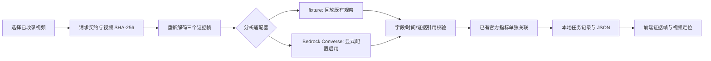

# 本地 Agent 骨架与 AWS 接入清单

更新：2026-10-10。当前交付是可运行的本地工作流，支持 `fixture` 和已核验的赛事 Bedrock 模型。本机已启用 Sonnet 4.6 并完成真实网页 SDK 验证；启动、用量和凭据区域说明见 [BEDROCK_INTEGRATION.md](BEDROCK_INTEGRATION.md)。仓库无 `.env` 时默认 fixture。

## 启动

Node.js 24，仓库根目录：

```powershell
npm ci
npm run agent
```

第二个终端：

```powershell
npm run dev
```

打开前端默认的「AI 作品」；选择样片或上传视频与数据，点击「生成解说作品」。离线模式按钮明确显示工程演示。开发和预览将 `/api` 转发到 `127.0.0.1:8080`。fixture 无需 AWS；Bedrock 在创建作品前检查 nba SDK 凭据，确认赛事项目并只在内存复用临时凭据。操作、数据格式、成片与实测见 [AI_FILM_GUIDE.md](AI_FILM_GUIDE.md)。

FFmpeg 为项目内 `ffmpeg-static@5.3.0` 依赖，首次安装会从其发布页获取平台二进制；npm 12 的安装脚本许可只开放这个固定版本。也可配置已有 `FFMPEG_PATH`，无需改系统 PATH。二进制遵循上游 FFmpeg/ffmpeg-static 许可，未提交到仓库。

## 数据流与真实能力



- 接受已收录样片与服务器注册的上传素材 UUID，拒绝请求传入任意路径或远程 URL。视频流式上传和四种 JSON 数据格式已有；未对齐记录不叠加到画面。
- 每次对预览 MP4 重新计算 SHA-256，对照台账；从视频实际解码三个 JPEG，保存实际帧 PTS、请求时间和图像哈希。帧位置来自既有关键时刻标注，**尚不是自动事件定位**。
- 素材原件哈希与预览哈希分开保存。本次处理的是约 29.97 fps 预览副本，不宣称原始视频逐帧精度。
- 默认 fixture 只回放既有 AI 观察，模型调用数与 token 使用均为 0；没有伪造推理进度、云调用或分析结果。进度来自真实阶段状态。
- 旧 analysis 模式保留 3 帧、1,000 输出 tokens。Web 使用 film 模式：最多 20 张 JPEG、1–6 段中文解说、2,400 输出 tokens，180 秒超时、单次请求。Sonnet 固定 JSON Schema，Qwen 严格解析，均检查真实时间/引用；数据数值由输入适配器独立提供。
- render 阶段已使用本机中文 TTS、ASS 字幕/xFG 图形、FFmpeg H.264/AAC 输出完整 MP4。Web、字幕和烧录数据卡共用时间轴，视频支持 Range 播放/下载；云端语音未实现。
- 调用尝试及响应原文/usage 在解析之前存盘；格式或字段失败也保留实际用量，未返回用量时记为未知。网页可查看原文、费用估算并导出记录；费用价格日期固定注明。
- 结构校验不能证明模型文本真实，真实模型结果始终标 `needs_review`。没有凭三帧推导球员引力、速度、距离或因果结论。
- 任务串行执行，最多 4 个待处理/运行任务；本地保存上限 200 条，列表展示最近 20 条。失败保留错误码，不自动重复调用；服务重启将未完成任务标为中断，防止隐式重收费。
- 浏览器展示接口错误、失败阶段、历史任务、证据帧、结果下载和对应视频定位。刷新页面可从后端恢复记录。

## 内部接口

| 接口                                  | 行为                                                         |
| ------------------------------------- | ------------------------------------------------------------ |
| `GET /ping` / `GET /api/health`       | `Healthy` / `HealthyBusy`，适配器、模型 ID、区域及付费开关   |
| `POST /api/jobs`                      | 校验后返回 202 和任务；后端继续处理                          |
| `GET /api/jobs`                       | 最近 20 个任务                                               |
| `GET /api/jobs/:id`                   | 任务状态与阶段                                               |
| `GET /api/jobs/:id/result`            | 已完成内部结果；未就绪返回 409                               |
| `GET /api/jobs/:id/frames/:index.jpg` | 已完成任务的真实提取帧                                       |
| `POST /invocations`                   | 同步运行相同流程并返回内部结果，路径符合 AgentCore HTTP 契约 |
| `POST /official/invocations`          | 明确返回 501，避免把内部格式当作赛事协议                     |

内部请求：

```json
{ "schemaVersion": "courtside.agent.request.v1", "clipId": "train_002" }
```

上例兼容 fixture。Bedrock 请求必须显式加 `"executionMode":"bedrock"`，否则后端拒绝，防止旧页面状态误触收费。模型选择在服务端配置，不接受请求任意指定模型。

任务请求上限 16 KB，数据 JSON 上限 2 MB，视频二进制上限 512 MiB。新上传/连接/作品接口见 [AI_FILM_GUIDE.md](AI_FILM_GUIDE.md)。来源限定本机开发/预览，校验 Host；FFmpeg 对输入限制 demuxer 和 file/pipe 协议，不从上传文件里的播放列表访问网络。当前不是公网多用户服务。

## AWS 接入边界

当前固定赛事 `nba / us-east-1`，禁止 default、个人项目和任意未核验模型/路由回退。两款白名单为 `global.anthropic.claude-sonnet-4-6` 与 `qwen.qwen3-vl-235b-a22b`，前者是赛事指南明确提供且已实测的 Global 路由；请求入口区域不等于实际推理单一区域。

模型运行需要 `AGENT_PROVIDER=bedrock` 和 `ALLOW_PAID_MODEL_CALLS=true`；本机按用户明确授权已配置。Sonnet 默认为 Bedrock 候选，网页真实 SDK 任务已完成，并保留 `needs_review`。fixture 配置仍可使用，完整启动与切换见 [BEDROCK_INTEGRATION.md](BEDROCK_INTEGRATION.md)。

凭据显式来自 `fromIni({profile:"nba"})`，SSO 使用自身登录区域 us-west-2，工作角色和 Bedrock 使用 us-east-1；不把登录缓存或临时密钥复制到项目或容器。云端执行角色凭据模式仍待实现。

## 基础设施骨架

已提供 `infra/app.ts`，通过 `npm run infra:synth` **离线**生成 CDK 模板；不需要 AWS 凭据、不查询云端、不构建容器、不上传素材。模板包括：

- 两个私有 S3 bucket（前端文件 / 结果储备），强制 TLS、版本控制、保留删除策略。
- CloudFront + S3 Origin Access Control，HTTP 重定向 HTTPS。
- HTTP AgentCore Runtime，使用外部已核验执行角色 ARN 和 us-east-1 ARM64 ECR 镜像 digest 两个必填参数；模板内模型调用仍禁用。
- 模板区域固定 us-east-1，无 Lambda@Edge 或自动 bootstrap。

这是可合成的资源定义，**没有部署**。静态前端资源上传、CloudFront 到鉴权 API 的连接、云端任务持久化与 S3 读写、角色最小权限/赛事 boundary 都待接入。不能把直接上传 `dist` 视为完整云上线。容器配方在 `agent/Dockerfile`，使用系统 FFmpeg、普通 `node` 用户、8080 端口；本轮未执行 Docker 构建。

## 资源到位后的接入顺序

1. 核对实际项目、profile、区域、赛事 Portal 绑定仓库，以及模型访问权限/非零配额；维持本地 fixture 可运行。
2. 获取**官方输入 JSON、输出 JSON、超时与重跑要求**；只修改 `agent/official-adapter.ts` 与相关契约测试。
3. 两模型 CLI 和 Sonnet 网页实测已完成；继续第二片、密集帧与质量扩样，保留 usage、时延、错例及待复核状态。单片实测不宣布模型排名，不自动降级。
4. 上传入口已扩大；下一步接入可靠的事件时间发现，保留三种时钟和事实来源边界。
5. 本地解说/标注成片和下载已完成；补齐语义复核、正式考试片和官方返回包。
6. 明确部署授权后，核验执行角色/权限边界，补齐云端存储与鉴权 API，再评审 CDK 差异、部署并验证。最终提交平台另按授权执行。

此前两段离线观察和单帧网页模型流程保留；新增真实上传→Sonnet→中文解说/数据成片→Web 播放/定位/下载已完成，31 项测试通过。官方协议、预置资源、运行时凭据/跨平台语音与云部署仍待完成。当前任务见[执行方案](PROJECT_PLAN.md)。

## 验证与资料

实际验收结果见 [AGENT_ACCEPTANCE.md](AGENT_ACCEPTANCE.md)。测试覆盖输入拒绝、费用/区域边界、真实抽帧、来源保留、失败持久化、重启中断及 HTTP 接口；不以离线测试代替云端可用性证明。

已读取本机 `amazon-bedrock`、`aws-cdk` 技能；SDK 文档使用 Context7，CDK 查询遇到连接错误后改用官方参考：

- [AgentCore HTTP 契约](https://docs.aws.amazon.com/bedrock-agentcore/latest/devguide/runtime-http-protocol-contract.html)
- [Bedrock Converse JavaScript SDK 示例](https://docs.aws.amazon.com/sdk-for-javascript/v3/developer-guide/javascript_bedrock-runtime_code_examples.html)
- [SDK 凭据提供器](https://docs.aws.amazon.com/sdk-for-javascript/v3/developer-guide/migrate-credential-providers.html)
- [CDK CfnRuntime](https://docs.aws.amazon.com/cdk/api/v2/docs/aws-cdk-lib.aws_bedrockagentcore.CfnRuntime.html)
- [CDK 私有 S3 origin](https://docs.aws.amazon.com/cdk/api/v2/docs/aws-cdk-lib.aws_cloudfront_origins.S3BucketOrigin.html)
