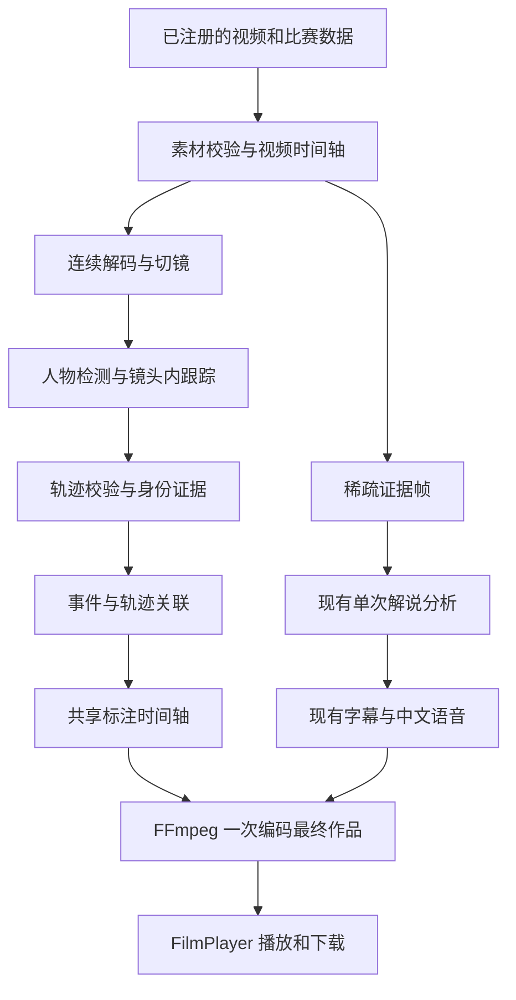

# NBA 深度赛场 球员追踪与成片接入设计 v1.1

更新：2026-10-10（北京时间）。状态：**现有成片流程已核对；球员检测、连续追踪和跟随标注仍待实现**。保留原文件名，避免已有引用失效。

本次只更新这份设计，不修改应用、基础设施或运行配置，不调用付费模型、不部署、不训练、不提交评测或推送 Git。AWS 资源与价格沿用 2026-10-10 此前的只读盘点，更新设计不等于再次核验资源状态。

## 1. 本版要交付什么

输入一段真实比赛视频及对应的 NBA 数据，自动输出能跟随球员的画面标注、轨迹 JSON，再交给现有解说与成片流程，通过 Web 播放和下载。

例如：射手移动、接球和起跳时，标签跟随同一条轨迹；身份确认后显示姓名及对应官方数据。遮挡或切镜后，系统明确保留不确定状态，避免把标签和指标挂到另一人身上。

首版完成 **画面内位置与镜头内连续跟踪**。球场米制坐标属于下一层能力，只有标定通过才展示。模型、视频 ID、球队和球员不写死；已有两段视频只是验收样本，不是正式输入白名单。

### 1.1 最新代码中的实际能力

以下根据当前本地代码核对，包含尚未提交的改动；不是只按 Git 已提交版本判断。

| 能力 | 当前实现与证据 | 本次设计增量 |
| --- | --- | --- |
| 视频与数据输入 | [media.ts](../agent/media.ts)、[match-data.ts](../agent/match-data.ts) 支持注册新素材、输入记录和显式视频时间 | 复用入口，追踪工具接收服务器解析后的素材，不能绕过注册入口传任意路径 |
| 视觉分析 | [story.ts](../agent/story.ts) 规划 1–6 个时间窗口，每窗两张证据帧，再加入事件帧；[frames.ts](../agent/frames.ts) 提取带 PTS 的 JPEG | 增加连续帧追踪支路；稀疏帧继续用于解说，不能作为连续轨迹 |
| 解说 | Bedrock 输出文字、时间、证据帧 ID；现有提示不允许凭稀疏帧判断球员身份、速度或距离 | 首版沿用解说契约，不因新增追踪就开放未经验证的因果或米制描述 |
| 数据图形 | [render.ts](../agent/render.ts) 在固定位置烧录姓名、事件、xFG 卡；[film.ts](../shared/film.ts) 控制显示区间 | 保留独立事件卡，新增根据轨迹移动的标注 |
| 旧工作台姓名牌 | [App.tsx](../src/App.tsx) 读取 clip 的姓名/号码；[styles.css](../src/styles.css) 固定 left:18px、bottom:21% | 继续定义为资料信息牌，不能标成追踪结果或直接拿来当跟随标签 |
| Web 作品 | [FilmPlayer.tsx](../src/FilmPlayer.tsx) 播放已合成 MP4，显示当前解说和事件指标；[AgentPanel.tsx](../src/AgentPanel.tsx) 挂载作品 | 播放带跟随标注的新 MP4，并提供追踪文件下载和真实执行状态 |
| 追踪数据 | [shared/agent.ts](../shared/agent.ts) 没有 bbox、track ID、身份关联或轨迹字段；[pipeline.ts](../agent/pipeline.ts) 明确注明没有球员追踪 | 新增独立版本化轨迹与关联契约，不能把文字观察解析成坐标 |

已完成样片为 22.89 秒、7 张分析证据帧、3 段解说；任务与用量见 [成片验证记录](../output/film-validation-20261010/README.md)。本次只读查看其 18.8 秒画面，确认右上角为固定 44.5% 数据卡、底部为字幕；没有人物框、脚下标记或轨迹线。成片 SHA-256 与既有记录一致。

### 1.2 不纳入本次增量

不训练检测器或基座模型，不用大模型逐帧定位，不新增向量数据库，不推断跨镜头同一身份，不做三维姿态重建、米制跑速、球员引力或因果评分。不修改现有页面布局，不做手机端适配。新模型接入、云部署和公开创作入口分别验收，不与追踪首版混在一次实施中。

## 2. AWS 资源盘点快照

此前盘点的 CLI 操作显式使用 `--profile nba --region us-east-1`。STS 返回目标项目 `414702114718` 和 `NBAHackathonParticipantRole`，不是登录角色或个人项目。原始最小字段证据见 [只读资源盘点](evidence/player-localization-20261010.json)。本次文档更新没有重新调用这些资源 API。

| 资源 / 能力 | 2026-10-10 盘点结果 | 本方案如何使用 |
| --- | --- | --- |
| 工作身份 | STS 核验成功 | `nba` 用于开发操作；`nba-sso` 只用于登录 |
| 赛事 S3 桶 | `nba-hackathon-414702114718-team11` 存在；位置返回 null，即 us-east-1 | 拟复用为视频、轨迹、成片与发布清单存储；写权限和桶策略还需验证 |
| CDK bootstrap 桶 | `cdk-hnb659fds-assets-414702114718-us-east-1` 存在 | 仅用于既有 CDK 资产流程，不当成业务素材桶 |
| CDK bootstrap ECR | `cdk-hnb659fds-container-assets-414702114718-us-east-1` 存在 | 证明容器资产仓库存在；镜像发布权限和 ARM64 镜像尚未验证 |
| CloudFormation | `CDKToolkit`、`risk-health-probe`、`team-access` 均为 CREATE_COMPLETE | 复用 bootstrap；不修改主办方基础栈 |
| Sonnet 4.6 Global | 推理配置 ACTIVE | 主解说候选；过去已有真实调用证据，本轮未推理 |
| Qwen3-VL 235B | AUTHORIZED；agreement、entitlement、region 均 AVAILABLE | 难例复核候选；不自动双模型调用 |
| EC2 | 当前区域实例清单为空 | 不能把“已有 GPU/服务器”作为方案前提 |
| AgentCore Runtime | 当前区域 Runtime 清单为空 | 必须后续按授权部署，不能声称已上线 |
| CloudFront | 分发清单为空 | 必须后续按授权部署，不能声称已有公网作品链接 |
| SageMaker | endpoint 清单为空；本次 processing job 清单为空 | 无已核验定位算力，不作为首版依赖 |
| Polly | DescribeVoices 遇到 TLS EOF | 记为网络核验失败，不判断为服务不可用或权限拒绝；未调用语音合成 |

桶名中的 `team11` 是本轮实际返回的预置资源名，业务操作仍通过目标项目的 `nba` profile；不能因此切换到 SSO 登录项目或 default。

盘点成功不等于资源写入、部署、模型批量容量或剩余额度已经通过。`NBAHackathonParticipantRole` 自身的 PermissionsBoundary 字段为 null，也不能据此推断新建角色不需要权限边界。

## 3. 赛事约束与技术取舍

已读取用户提供的《NBA × AWS Hackathon｜赛制与选手快速上手 Rules & Quick Start》：AgentCore、CloudFront、CDK 是赛事硬要求；业务区域只能是 us-east-1；主办方已完成 bootstrap，不应再次 bootstrap；新建 IAM 角色需遵守 `NBAHackathonParticipantBoundary`。指南明确 EC2 GPU 配额为 0，GPU 要走 SageMaker 且容量不保证。本轮没有重新查询实时 GPU 配额，也没有申请配额。

因此采用以下路径：

- **本地阶段**：验证预训练检测与跟踪的质量，产出真实标注视频和轨迹，不依赖新云资源。
- **首版云端候选**：把定位、数据关联和渲染作为 AgentCore 的 CPU 工具，由它组织执行；Bedrock 负责有依据的解释与解说。容器兼容性和速度通过后，才能认定此候选可部署。
- **暂不依赖 GPU**：没有通过 CPU 验收门槛时，先评估模型导出、输入尺寸与分段处理；确实需要 GPU 再核验 SageMaker 允许的服务形态、角色、配额、报价和资源回收方案。不得直接开 EC2 GPU，也不自动切区。

官方文档核验到的标准 AgentCore Runtime 限制：ARM64、HTTP 8080；单会话硬件上限 2 vCPU / 8 GB，容器镜像上限 2 GB、会话临时存储上限 1 GB。同步请求最长 15 分钟；长任务需要按协议设计异步或流式过程。这些是服务文档限制，不是本项目已部署性能。[HTTP 契约](https://docs.aws.amazon.com/bedrock-agentcore/latest/devguide/runtime-http-protocol-contract.html)、[资源与调用限制](https://docs.aws.amazon.com/bedrock-agentcore/latest/devguide/bedrock-agentcore-limits.html)

## 4. 球员定位方法

### 4.1 连续视频与镜头处理

使用视频实际解码时间戳 PTS。定位模块连续处理帧；Bedrock 的稀疏证据帧不能代替完整轨迹。检测切镜、回放、特写等情况，每个镜头分别维护跟踪状态。

首轮针对短片离线处理，保存源帧率、处理帧率和缩放变换。降帧或缩放必须显式记录；跟踪器的丢失缓冲按真实秒数换算，不能把 60 fps 视频的帧数当成 30 fps 的时长。跨切镜不沿用旧轨迹。

### 4.2 人物检测

首轮用预训练 YOLO 中等规模权重建立质量基线，具体型号、版本和权重 SHA-256 写入配置与结果。根据同一批标注实测选择权重，不默认最大模型最好，也不因 CPU 速度未经测量就直接降到最小模型。

检测输出人物框，再结合球场区域和球衣特征识别球队候选。裁判及不确定人物保留单独/未知类别；不强制每帧检测十名球员。输入缩放后，坐标必须还原到原视频尺寸再渲染。

### 4.3 连续跟踪与向量匹配

首选 **BoT-SORT + 相机运动补偿**，显式配置跟踪器，不依赖库版本的默认选择。先验证运动关联基线；如错例集中于遮挡后串人，再用同一批视频比较启用 ReID 的结果。最终只保留验收更好的配置。[官方跟踪文档](https://docs.ultralytics.com/modes/track/)、[BoT-SORT 论文](https://arxiv.org/abs/2206.14651)

ReID 是球员外观特征的相似性匹配，不是球场距离，也不是身份证明。每个镜头仅少量轨迹，直接在内存比较特征即可；首版不新增向量数据库或 Embedding 服务。

标注状态区分 `detected`、`predicted`、`occluded`、`lost`。短时预测只维持视觉连续性；长时丢失隐藏标签，不把预测框当作可测量的真实位置。缓冲时长由验收样本确定并写入配置。

### 4.4 身份与官方数据关联

通过球衣号码、多帧一致性、球队和比赛名单关联真实球员。镜头内 `track_id` 与官方 `player_id` 分开存；编号相同不代表真实身份相同。

号码 OCR 只用于清晰的球衣裁剪区域，不让单帧模糊识别覆盖已确认身份。不确定时显示“球员 T07”等临时标签；允许一次人工确认作为纠错入口，并记录证据和确认范围。

只有身份与事件匹配成功，才将个人指标挂到跟随标签。匹配不完整时，数据留在独立事件卡，不随机绑定人物。赛季指标、单次事件指标和检测得分分别保留语义；xFG 不能当作识别置信度。

### 4.5 球场坐标：条件通过后再启用

先用人物框底部中点作为画面标记的近似锚点，不声称是精确地面位置。需要米制坐标时，用至少四个分布合理、非共线的球场对应点建立平面映射；增加独立验证点检查误差。镜头平移或变焦后更新映射，跟踪器的相机补偿不能替代球场标定。[OpenCV 平面映射文档](https://docs.opencv.org/4.x/d9/dab/tutorial_homography.html)

球员腾空、脚部遮挡、画面裁切或标定无效时，`court_xy_m` 留空。未通过独立误差检查前，不输出米制距离、跑速、空间大小或引力测量。

## 5. 接入现有 Agent 与成片流程

### 5.1 本地先形成闭环

保留现有 Node / TypeScript 编排，由独立 Python 视觉工具执行预训练推理。二者通过固定内部参数和任务目录的 JSON 文件通信，不新增长期运行的视觉 HTTP 服务。模型权重、跟踪器及配置由服务端白名单选择，不接受上传脚本或任意权重路径。



追踪请求的拟定阶段为 `material → tracking → binding → frames → analysis → validation → render → package`。`tracking` 包含坐标、时间、哈希与切镜边界校验，在收费分析前完成。未开启追踪的旧任务继续使用现有六阶段；读取旧任务不能改写阶段或自动重跑。

视觉工具使用内部素材路径、任务输出目录和版本化配置，Node 通过参数数组启动进程并控制超时、退出码、日志长度与资源记录。执行失败不能悄悄生成一份声称有追踪的成片。CPU 速度与依赖兼容性由本地实测决定，不预设已有 GPU 或云端部署能力。

### 5.2 标注在画面中如何体现

| 元素 | 位置与数据来源 | 显示规则 |
| --- | --- | --- |
| 人物框 | 当前有效 bbox，对应源视频 PTS | 首个验收作品默认显示，便于核对漏检与串人；已分类裁判不当作球员 |
| 临时 ID / 姓名 | 人物框上缘附近，随框移动 | 未确认显示 `球员 T07`；有证据的身份才显示姓名。T07 不等于官方球员 ID |
| 脚下标记 | bbox 底部中点 | 只是画面定位辅助，不宣称是真实脚部接地点；脚部裁切时隐藏此标记 |
| 短轨迹线 | 同镜头、同轨迹的有效锚点 | 默认只画近 0.8 秒，时长写入配置；标注为画面轨迹，禁止用线长计算米制距离或跑速 |
| 选中球员高亮 | 当前轨迹框和标签 | 点击轨迹列表中的 ID 后高亮；可以先按匿名轨迹选择，不要求先知道姓名 |
| 球员事件徽标 | 已确认身份且明确关联事件的轨迹 | 仅在该事件显示区间内挂 xFG / 事件提示；姓名相同或时间接近都不足以证明关联 |
| 独立事件卡 | 复用当前右上角卡片 | 保留有视频时间的记录；未绑定轨迹时仍能显示，但注明未绑定画面人物，避免产生识别已确认的暗示 |

默认只渲染当前有效检测。`predicted / occluded / lost` 保留在轨迹文件供诊断，但不作为默认实测位置绘图。若后续启用短间隔插值，必须写明最大间隔与 `interpolated` 来源，同镜头且两端有效；禁止跨遮挡长缺口或切镜补线。切镜立即清除旧框、旧标签和短轨迹。

画面坐标统一保存在解码后的源显示平面；旋转、SAR、缩放、补边及推理 letterbox 的变换都写入 manifest。以当前最终画布 1280×720 为例，设源显示尺寸为 W×H：`s=min(1280/W,720/H)`、`offsetX=(1280-sW)/2`、`offsetY=(720-sH)/2`，最终位置为 `(s*x+offsetX, s*y+offsetY)`。不能把模型缩放图上的坐标直接覆盖到成片上。

当前 ASS 中固定的事件卡继续保留。跟随标注由共享标注编译器依据轨迹生成按 PTS 生效的 ASS 绘图和标签，再与原视频、字幕及音轨一次编码，避免把中间追踪预览重复压缩成最终作品。ASS 的时间精度与输出帧 PTS 都需核对；不能用不断累加的估算帧号代替 VFR 视频时间。

### 5.3 Web 与下载作品保持一致

首版 `FilmPlayer` 播放烧录了追踪标注的 MP4；解说定位、指标同步和下载继续走现有入口。已烧录的视频上不再叠加同一套 SVG 框，避免出现双框和不同步的标签。Web 显示追踪来源、版本、覆盖情况，并提供轨迹与身份关联文件下载。

“隐藏人物框、选择高亮球员”等交互如果需要在导出作品中生效，使用已保存轨迹、原视频和已有解说重新渲染，不能只改 CSS 或再次调用 Bedrock。下一阶段的可编辑预览才使用原视频 + SVG，并读取同一份共享标注时间轴；它不是首个追踪闭环的必需项。

旧回合工作台的固定姓名牌保持资料信息牌语义，不能通过更名冒充追踪。新作品缺少追踪结果时显示“未执行追踪”；视觉工具失败时显示失败阶段，不展示随机框或人工造轨迹替代。

### 5.4 拟改文件与职责

以下是实施清单，文件名中的“新增”不表示本次已经创建。

| 文件 / 模块 | 拟定职责 |
| --- | --- |
| 新增 `vision/track.py`、配置及锁定依赖 | 连续解码、切镜、预训练检测、BoT-SORT、输出轨迹和资源用量；不调用 AWS |
| 新增 `agent/tracking.ts` | 调用视觉子进程、校验 manifest / 时间 / 坐标 / 配置哈希；读写范围仅当前任务目录 |
| 新增 `agent/track-bindings.ts` | 轨迹身份与事件关联；不以姓名字符串或最近轨迹自动绑定 |
| 新增 `shared/tracking.ts` | 版本化轨迹、身份、关联与产物契约 |
| 新增 `shared/tracking-overlay.ts` | 纯时间与几何规则：状态过滤、变换、可见区间和短轨迹；供烧录与未来 SVG 共用 |
| `shared/agent.ts`、`agent/contracts.ts` | 接受下节拟定 v2 请求与结果，保留 v1 读取；新增字段仍严格校验 |
| `agent/pipeline.ts`、`agent/jobs.ts` | 按请求启用追踪与关联阶段、保存产物引用和失败状态；保持旧任务兼容 |
| `agent/render.ts`、`shared/film.ts` | 复用事件区间，合成跟随图形；轨迹不改变真实 xFG 值 |
| `agent/server.ts` | 新增轨迹产物的精确文件白名单与只读下载；禁止任意文件枚举或路径穿越 |
| `src/AgentPanel.tsx`、`src/FilmPlayer.tsx` | 显示追踪开关/状态、轨迹下载与作品；不改整体布局，不把恢复任务变成收费重跑 |
| 拟新增追踪与成片测试 | 校验切镜、时间、缩放、身份冲突、失败、旧任务恢复与烧录结果 |

### 5.5 失败与恢复

| 情况 | 行为 |
| --- | --- |
| 请求明确要求追踪，但工具或权重缺失 | 停在 tracking，返回明确失败；不执行本次收费解说 |
| 轨迹哈希不符、时间越界、坐标非法 | 停止使用产物，不渲染，不靠裁剪数值掩盖无效输入 |
| 部分帧漏检 / 身份不确定 | 保留缺口与匿名 ID，隐藏无效标注，报告覆盖情况；不强制十人或虚构姓名 |
| 全片没有合格的场内人物定位 | 追踪请求失败，保存诊断；不能将无标注作品记为追踪成功 |
| 身份与赛事名单或事件冲突 | 取消人物数据挂载，独立事件卡保留；冲突可追溯 |
| 解说已保存，渲染失败 | 显式重渲染入口只读取有效缓存，不重新调用模型；当前代码尚没有此恢复入口 |
| 刷新、恢复历史任务或下载文件 | 只读已有产物，不创建新推理任务 |

缓存键至少包含实际分析视频哈希、追踪依赖/权重/配置哈希、数据哈希、身份关联版本和标注版本。沿用解说时还要匹配分析模型、提示与证据版本；不把同名文件视为相同输入。

### 5.6 模型与 AWS 分工

检测和定位采用预训练视觉工具。主流程保留已实际调用过的 Sonnet 4.6 与 Qwen3-VL 适配器；新模型不会因目录可见而自动替换默认值。[当前模型配置](../agent/config.ts) 仍只接受这两款。

Grok 4.7 与 Kimi K3 在此前本会话只读检查中可用性和授权状态通过，尚未真实推理、尚未加入应用白名单。二者 Bedrock 版本支持图片/文本和结构化输出，不直接接收视频或音频；候选比较沿用同一组带时间戳抽帧，不把它们当逐帧追踪工具。[Grok 官方说明](https://docs.aws.amazon.com/bedrock/latest/userguide/model-card-xai-grok-4-7.html)、[Kimi 官方说明](https://docs.aws.amazon.com/bedrock/latest/userguide/model-card-moonshot-ai-kimi-k3.html)

云端候选仍是赛事 S3 保存对象、AgentCore 组织 CPU 工具、Bedrock 生成解说、CloudFront 展示已发布作品。本地闭环验收后才评估云端迁移；此前盘点未发现已部署 AgentCore / CloudFront。开发 CLI 固定 `nba / us-east-1`，运行时改用执行角色，不携带本地 SSO。推理配置可能跨区域路由，新模型路由需核对赛事政策，不能以调用入口替代实际区域判断。

公网上传和付费创作另需鉴权、配额、持久化与 API 连接。Vite 本地 `/api` 代理不等于 CloudFront 后端；Polly 仍是云端语音候选，尚未接入。

## 6. 接口与输出约定

以下为拟定内部接口，**当前服务尚不接受这些新增字段**；不冒充 Portal 官方 sample。轨迹独立存储，不能把数千条位置记录塞进当前只接受最多 200 条事件的 MatchData。

### 6.1 请求与兼容性

保留现有 `courtside.agent.request.v1` 请求与旧作品行为。新增追踪能力使用明确的内部 v2：

```json
{
  "schemaVersion": "courtside.agent.request.v2",
  "clipId": "38172313-7741-4c53-ba9b-e258af2519c3",
  "executionMode": "fixture",
  "outputMode": "film",
  "trackingMode": "required"
}
```

示例 clipId 仅说明已注册 UUID 格式，不规定输入素材。v2 的 trackingMode 支持 `none / required`，省略等同 none；首版只允许在 film 模式启用追踪。`required` 失败时必须报错，没有“失败后自动当作成功”的模式。fixture 只决定解说是否收费，不允许伪造真实视频的追踪；真实追踪结果必须注明预训练推理来源，回归测试夹具另标测试来源。

v1 返回既有 result.v1；v2 返回 result.v2，保留已有 observation / usage / film 字段并新增可选 tracking 产物引用。历史任务缺少 tracking 时解释为“未执行”，不能展示为已完成。服务端解析器、共享类型、Web 创建请求及恢复历史的逻辑需要一起实施；只改前端发送字段会被现有严格解析器拒绝。

追踪所需权重、处理尺寸、帧率和渲染预设通过已核验服务配置解析，浏览器不能提供任意脚本、配置文件路径或执行命令。云端迁移后由素材适配器将授权 S3 对象引用映射成素材 ID；不把大视频 Base64 塞进模型，不接受其他项目对象或任意远程 URL。

### 6.2 逐帧轨迹与身份关联

```json
{
  "schema_version": "courtside.player-track.v1",
  "video_sha256": "<源视频哈希>",
  "coordinate_space": "source_video_pixels",
  "frame_width": 1920,
  "frame_height": 1080,
  "pts_seconds": 18.0514,
  "frame_index": 541,
  "segment_id": "segment-003",
  "track_id": "T07",
  "bbox_xyxy_px": [800, 300, 930, 700],
  "anchor_px": [865, 700],
  "anchor_method": "bbox_bottom_center_approximation",
  "status": "detected",
  "detector_score": 0.91,
  "player_id": null,
  "identity_status": "unconfirmed",
  "identity_evidence": [],
  "court_xy_m": null,
  "calibration_id": null
}
```

这是字段示例，坐标与分数不是本次推理结果。`segment_id` 是镜头分段，不能与 NBA 投篮事件 ID 混用。`frame_index` 只用于索引；时间以 `pts_seconds` 为准。坐标空间指实际解码且处理显示旋转/SAR 后的源视频平面，尺寸与变换由 manifest 声明。轨迹主键为视频哈希 + segment ID + track ID，T07 可以在不同镜头重新出现但不代表同一人。

`tracks.jsonl` 每行一个轨迹观测，按 PTS、镜头和轨迹排序，保留被排除人物的分类/原因及缺口统计。身份确认记录另存 `identity-links.json`，至少包含作用轨迹、有效时间范围、game/player ID、球队/号码、确认状态、方法和证据帧。当前上传数据没有完整比赛名单和官方 player ID 时，可以先保持匿名，不能从姓名字符串制造 player ID。

事件绑定记录另存 `event-track-links.json`，至少包含 event ID、镜头与 track ID、事件时间和依据。输入记录增加可选 gameId/playerId/jersey/team 等关联字段时，应同步改适配器与校验；没有这些字段的旧数据仍有效。确认身份、确认事件、确认时间三项都成立，且没有镜头/身份冲突，才允许个人指标挂到轨迹。

### 6.3 产物与标注时间轴

| 产物 | 用途 |
| --- | --- |
| `tracks.jsonl` | 源视频位置与状态，可下载审计；大文件不整体放入 Job JSON |
| `identity-links.json` | 轨迹身份与证据；未知身份明确留空 |
| `event-track-links.json` | 数据事件与画面人物的明确关联；不能替代输入记录真实性核验 |
| `tracking-manifest.json` | 视频/依赖/权重/配置哈希、时间原点、帧率、尺寸变换、镜头范围、统计与产物引用 |
| `overlay-timeline.json` | 共享编译后的标注指令及来源引用；Web 与编码消费同一版本 |
| `tracking-preview.mp4` | 第一阶段无收费解说的定位验收视频，可选保留 |
| `film.mp4`、VTT、原作品时间轴 | 复用最终作品格式；时间轴增加追踪版本与产物引用 |

产物路径由服务端构造，公开下载只返回同一完成任务的白名单文件。manifest 不包含凭据或不必要的本地绝对路径。小型示例可以完整加载标注；长片需要按镜头/时间范围索引或分块，不能把全量逐帧轨迹复制进每次 React 渲染。

共享标注指令至少描述 `start/end`、segment/track ID、图形类别、源坐标、文本、渲染状态及来源观测。人物显示与事件徽标分别按轨迹状态和 `dataOverlays` 区间判定；字幕独立按 narration cue 播放。缺少真实身份仍可输出临时 ID 视频，缺少标定不阻断画面像素坐标输出。

## 7. 云端实现门槛与 CDK 约束

以下是待实施门槛，本轮没有修改基础设施：

1. CPU 候选先按每段 20–60 秒处理；长视频保留原输入，通过镜头/时间段切分完成，不限制固定素材 ID。处理分辨率与帧率写入 manifest。
2. 先验证 ARM64 环境的检测、跟踪、FFmpeg 与中文字体。可使用 Python 视觉子进程，但保留现有 Node 编排。若导出 ONNX，比较同一证据上的检测结果，不能把导出成功当作正确性通过。
   当前 [Dockerfile](../agent/Dockerfile) 是 Linux Node/FFmpeg 骨架，而 [render.ts](../agent/render.ts) 的语音需要 Windows Huihui、字体来自 C:/Windows/Fonts；当前本地成片成功不能证明 Linux 云端可以成片。需先抽出语音/字体适配器，核验字体授权与云端语音，再评估正式 Runtime 镜像。
3. 镜像需在 2 GB 上限内；缓存权重、视频和产物需在 1 GB 临时存储上限内。避免保存全量 JPEG；轨迹流式写出，分段结果尽早上传 S3。
4. 短片 CPU 路径的建议上线目标：60 秒视频总处理时间不超过 8 分钟、内存峰值不超过 6 GB、临时磁盘不超过 800 MB。均为规划目标，尚无基准实测；不达标则不能宣称此云方案已就绪。
5. 复用现有 CDK bootstrap，禁止再次 bootstrap。预置赛事桶用 CDK 引用，不擅自接管主办方资源的生命周期或覆盖桶策略。当前骨架定义的两个新桶需要在正式部署方案中与复用方式协调。
6. 新执行角色按赛事要求配置权限边界；人类开发角色不能直接当成 Runtime 执行角色。运行时使用角色凭据，不能依赖 `fromIni({profile:"nba"})` 或携带本地 SSO 缓存。
7. CloudFront 只开放明确的 `web/` 与 `published/` 内容。原始输入、待复核轨迹与调用日志保持私有；OAC 与桶策略变更必须保留既有主办方授权。
8. `/ping`、`/invocations` 与任务持久化遵守 AgentCore 协议。模型输出及 usage 落盘后，渲染失败只重试渲染；相同输入不能因刷新或恢复再触发付费模型。
9. 本轮仓库未发现 `cdk.json`；后续正式 CDK 入口需补齐 app 和赛事权限边界配置，再做 synth / diff。模板可合成、角色可读均不等于有部署授权或部署成功。

本轮未验证新增执行角色、S3 写入、ECR 镜像推送、ARM64 容器、AgentCore Runtime 调用、CloudFront 到 API 的鉴权及公网访问。

## 8. 成本估算与用量控制

定位与 ReID 使用预训练组件推理，不调用大模型逐帧定位，也不训练模型。开发期本地验证不新增云计算费用；电力、本地设备成本未计入。

Sonnet 使用项目 2026-10-10 已核验普通按需价率：输入 $3 / 百万 tokens、输出 $15 / 百万 tokens，来源见 [模型实测与价格证据](../output/model-validation-20261010/README.md)。AgentCore Runtime 官方按需价格页本轮读取到 $0.0895 / vCPU-hour、$0.00945 / GB-hour。[Runtime 价格](https://aws.amazon.com/bedrock/agentcore/pricing/)

示例假设：每个短片只调用一次 Sonnet，输入 10k–20k、输出 1k–2k tokens；每个 Runtime 会话假设 2 vCPU 实际计算 4 分钟、4 GB 内存保持 4 分钟。计算由 Python Decimal 执行，结果如下：

| 项目 | 单任务 USD | 100 个任务 USD |
| --- | ---: | ---: |
| Sonnet 模型 | 0.045–0.090 | 4.50–9.00 |
| AgentCore 示例 CPU + 内存 | 约 0.01445 | 约 1.45 |
| 两项小计 | 约 0.05945–0.10445 | 约 5.95–10.45 |
| 上述小计增加 30% 规划余量 | — | 约 7.73–13.58 |

这不是总账单或处理速度承诺：S3 存储/请求、ECR、CloudFront 交付、CloudWatch、Polly、失败调用和实际内存驻留时间另计；不能假定赛事额度覆盖全部费用。CPU 计算耗时与墙钟耗时可能不同，等待模型时内存仍可能计费。GPU 成本未包含，也不产生常驻 GPU endpoint。

付费模型单次明确 maxTokens、无自动重试、保存实际 usage；ReID 不另收 API 费用，但会增加 Runtime 用量。相同输入与配置按哈希复用已完成结果。金额提醒只是建议，尚未实现项目级硬预算，不把该表当作支出上限。

## 9. 验收标准与实施顺序

以下都是待验证目标，不是已测准确率。

| 验收项 | 首版通过条件 |
| --- | --- |
| 人物定位 | 两段样片各至少 30 个分层抽样帧，人工标注全部可见场内球员；清晰、无遮挡样本上 IoU ≥ 0.5 的检测召回率与精确率目标均 ≥ 90%；单独报告遮挡样本 |
| 关键球员跟踪 | 已人工核验的清晰连续段，关键球员 ID 切换为 0；遮挡段记录丢失和切换次数，不靠隐藏错误提高分数 |
| 镜头切换 | 所有验收切镜重置旧轨迹；不能带着旧标签跨画面跟人 |
| 身份准确性 | 不确定身份保留空值；展示姓名的轨迹均有号码/名单/人工确认等证据 |
| 渲染同步 | 标注与原视频对应帧一致，时间偏差目标不超过一个渲染帧；缩放坐标正确 |
| 画面一致性 | 固定人物/PTS 的期望位置在原视频、标注时间轴和最终 MP4 一致；视频右上事件卡不冒充跟随标注 |
| 缺口与状态 | 遮挡、丢失、切镜样本不显示无效人物框；短轨迹不跨缺口或切镜；预测位置不混为观测 |
| 指标绑定 | 没有确认身份和事件匹配时不挂个人 xFG；匹配有效时数值与输入一致，展示范围复用事件时间区间 |
| 兼容性 | 旧 v1 请求/结果和已完成作品可读；没有追踪字段时明确未执行；新 v2 不被解释为赛事协议 |
| 球场坐标 | 首版默认关闭；开启前在独立验证点报告误差，不将像素或外观相似度转换成米 |
| 输出与恢复 | MP4 能播放/定位/下载，JSON 可追溯；失败可定位阶段，恢复不重复模型收费 |
| 云端门槛 | ARM64 依赖、镜像、CPU 时间、内存、磁盘、角色与对象权限通过实测后才部署 |

功能验收不调整页面布局，不进行手机端布局测试。

| 优先级 | 执行任务 | 完成证据与后续门槛 |
| --- | --- | --- |
| P0 | 独立视觉工具：真实视频 → 人物框 + 镜头内 ID + 短轨迹 → tracking-preview.mp4 / JSON | 不调用 Bedrock；交付原片与标注片对应帧、人工标注、漏检/串人/切镜记录、模型配置哈希、CPU 时间/内存/磁盘峰值 |
| P1 | 把 P0 接入已注册素材、v2 任务和现有 film 流程 | 用已存解说或 fixture 验证带框 MP4、状态/下载/定位/历史恢复；收费调用前先通过轨迹校验 |
| P2 | 身份确认与事件绑定、选择轨迹与重渲染 | 姓名/指标有证据、未知保持匿名、绑定冲突隔离；改变标注仅重渲染，不重复模型收费 |
| P3 | ARM64 CPU、Linux 语音/字体、S3 持久化及公网展示设计 | 分别核验兼容性、容量、角色、桶/OAC/API 权限；对应授权后才能部署 |

**第一个可执行任务仍是 P0：实现独立定位工具，用已有阿门和弗拉格短片输出跟随人物框、匿名 ID、短轨迹的 MP4 与轨迹文件，先不接新模型或云资源。** P0 准确性验收前先抽样标注；至少增加一段未收录视频验证动态输入，未取得第三段之前不能声称泛化验收通过。

首个标注视频必须肉眼能看到框与 ID 随同一人移动，并能用 JSON 回查对应位置。随后 P1 复用现有解说和数据卡形成完整作品。米制标定、OCR 自动身份和云端迁移不得成为 P0 的前置依赖。

### 待定事项

- 具体检测器权重、处理分辨率、检测节奏、切镜阈值和丢失缓冲：以同一人工标注集的质量及 CPU 实测决定，锁定版本与哈希后再实施默认配置。
- 是否启用 ReID：先查看遮挡与同球衣串人错例，单独对比收益与资源消耗，不因向量搜索概念可用就引入数据库。
- 官方 player ID / 名单与新视频对应事件的完整度：当前事件接口不足以自动确认十名球员身份；缺失时 P0/P1 保持匿名。
- Grok / Kimi 是否加入应用：另做同证据小样本对比和费用/路由核验，追踪首版继续使用已有解说接口，不自动切换。

## 10. 依据与核验边界

- 项目基础：[现有技术栈与选型](../../NBA深度赛场_技术栈与选型建议.md)、[当前执行方案](PROJECT_PLAN.md)、[Bedrock 接入记录](BEDROCK_INTEGRATION.md)、[现有成片接口](AI_FILM_GUIDE.md)、[成片验证记录](../output/film-validation-20261010/README.md)、[Agent/CDK 骨架](AGENT_SKELETON.md)。主线程代码可能继续变化，实施前核对当前差异，不能覆盖他人改动。
- 赛事约束：用户提供的 `E:/下载/NBA × AWS Hackathon｜赛制与选手快速上手 Rules & Quick Start.md`。文档中的部署示例只是资料，不是本轮部署授权。
- 资源事实：[此前 AWS 只读盘点](evidence/player-localization-20261010.json)。只检查 nba / us-east-1，没有扫描其他区域；本次设计更新未重新盘点。
- 视觉依据：[Ultralytics 跟踪文档](https://docs.ultralytics.com/modes/track/)、[BoT-SORT 配置](https://github.com/ultralytics/ultralytics/blob/main/ultralytics/cfg/trackers/botsort.yaml)、[BoT-SORT](https://arxiv.org/abs/2206.14651)、[ByteTrack](https://arxiv.org/abs/2110.06864)、[平面映射](https://docs.opencv.org/4.x/d9/dab/tutorial_homography.html)。本次通过 Context7 核对了 BoT-SORT 相机补偿、可选 ReID 和连续帧状态保持；切镜重置与身份绑定是本项目设计责任，尚未推理验收。
- AWS 依据：[AgentCore HTTP 契约](https://docs.aws.amazon.com/bedrock-agentcore/latest/devguide/runtime-http-protocol-contract.html)、[Runtime 限制](https://docs.aws.amazon.com/bedrock-agentcore/latest/devguide/bedrock-agentcore-limits.html)、[Runtime 价格](https://aws.amazon.com/bedrock/agentcore/pricing/)。AWS CLI 的 Context7 查询发生传输失败，回退 AWS 官方文档；当前会话无可用 AWS MCP，因此使用 CLI 只读核验。

### v1.1 更新记录

补充当前代码与成片实况；将首次交付收敛为匿名人物追踪；细化现有 Agent 阶段、版本兼容、共享标注时间轴、MP4/Web 一致性、身份/事件绑定、失败与恢复、Linux 成片迁移缺口和 P0–P3 验收。AWS 盘点与成本仍为此前快照，不更新为新的实测结论。

初版使用技术提案与相关 AWS 技能整理；本次更新使用 writing-proposals，并复用 amazon-bedrock / aws-cdk 指南。技能不增加授权范围。已完成的是本地设计更新，追踪代码、定位性能、云端部署和公开作品分别需要实施与真实完成证据。
