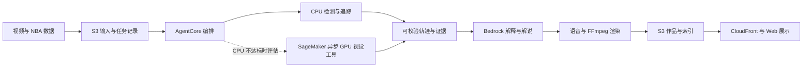

# NBA 深度赛场球员追踪开源优化计划

版本：v1.2
日期：2026-10-10  
状态：P0 评估工具、P1 关联候选、P3 CPU 性能和 P4 高清工程样片已本地执行；P2 已按用户粗标做临时球员视图。独立精度、身份连续性、泛化和云端性能尚未验收。

## 本轮执行更新

最新阶段：用户已审核 506 个离散球员框，默认切换为不读取人工标注的 `semantic_role_v1`：OpenAI CLIP ViT-B/32（MIT）、全人物裁剪、两次新鲜非球员观测投票、余量 0.02；长压缩裤仍可保留，短裤不作硬门槛。原始检测/轨迹实测字段及两片已匹配真值集合保持一致，清晰框精度阿门 73.2%、弗拉格 53.9%，召回率分别 85.1%、81.1%。90%/90%、连续身份和第三段未见视频泛化仍未通过。[最新对照](../output/player-generalization-20261010/README.md)。

用户随后明确要求停止本地效果核验、部署 AWS 并调用模型。当前 CloudFront/ECR/私有网站桶已创建；ARM64 CPU 镜像、运行时执行角色凭据、S3 持久化和 Polly 已准备，正在完成传输和 AgentCore 实跑。公网展示与 IAM 认证生成分开，尚不能把资源创建称为完整云端作品。下方 P0–P4 及价格保留各自历史阶段；当前执行不再限制为只读。

用户先授权推进工程和性能，随后提供两片各 30 帧、合计 505 个球员粗标框，并补充短裤线索。已完成本地 A/B/C 同检测比较、ReID 特征池修复、ONNX 数值/速度对照、连续标注页与 TrackEval 工具、5 秒 1080p 带框/数据/中文音轨工程片，以及粗标辅助筛选后的真实解说成片和 Web 验证。

粗标仍保留原始未审核标志，没有连续人工 ID，不当作独立 GT。短裤仅为多帧辅助线索，粗标参考限定同镜头邻近 450 ms，原始观测不删除。默认仍是 PyTorch 960 / BoT-SORT / ReID 关闭；低频、ONNX 与 ByteTrack 没有未经精度验收就自动采用。

当前 29 项 Python、44 项 Node、类型检查、构建及实际 Web 验证通过。此次新增 AWS 模型调用和资源均为 0，没有部署、训练、提交平台评测或 Git 提交/推送。完整证据见[工程与性能](../output/tracking-engineering-performance-20261010/README.md)、[球员粗标筛选](../output/coarse-player-tuning-20261010/README.md)。下文保留阶段依赖和资源/价格快照，不能把规划门槛当作已达成。

## 1. 目标与推进顺序

基于现有“真实比赛视频＋NBA 数据→人物追踪与数据可视化→中文解说 MP4→Web 播放和下载”的系统，提高球员定位、镜头内身份连续性和首次处理新视频的速度。

采用 **保留当前基线→独立标注评估→少量开源候选比较→CPU 优化→AWS 最小验证→完整作品部署** 的顺序。GPU 是 CPU 不达标时的备用执行路径，不是开源追踪比较的前置条件。

本计划不开展强化学习、基座模型训练或自定义微调，不调整布局或手机端。制定计划和准备本地文档不自动授权云部署、付费调用或平台评测；这些动作按其对应授权执行。

## 2. 当前实现与真实证据

### 2.1 可复用的工程能力

| 项目 | 当前状态 | 优化中如何复用 |
| --- | --- | --- |
| 检测 | YOLO11m，960 输入尺寸，2 个实际 Torch 推理线程 | 固定权重和输入，建立检测基线；`maxFps=60` 是采样上限，不代表推理速度 |
| 关联 | BoT-SORT、sparseOptFlow，`fuse_score=false`，ReID 默认关闭 | 以当前配置为基线，不恢复到已修正的早期配置 |
| 场地筛选 | 尺寸合格检测先关联，再按估计地板区域决定是否绘制 | 保留场外观测的关联作用；审查边线、腾空和裁判错例 |
| 检测缓存 | 按视频、权重、检测参数、PTS 和依赖版本校验 | 同一检测结果用于比较关联方案；不缓存预测位置 |
| 视频产物 | 实测人物框、镜头内匿名 ID、短轨迹、MP4、JSONL | 继续遵守切镜清除旧轨迹、缺口不冒充实测位置的规则 |
| Web 检索 | 小型人物索引，按镜头和匿名编号检索、跳转、下载 | 用于回查具体失败时刻，不把匿名编号解释成球员姓名 |
| 解说 | 现有 Sonnet/Qwen Bedrock 接入，支持显式复用已生成解说 | 视觉比较复用相同解说，避免重复收费干扰实验 |
| 身份与场地坐标 | `player_id`、`court_xy_m` 尚未确认 | 未确认时留空，不把 xFG 等数据随机挂到匿名人物上 |

源码依据：[视觉配置](../vision/profile.json)、[关联配置](../vision/tracker.yaml)、[检测缓存](../vision/detections.py)、[实验 ReID](../vision/appearance.py)、[实验角色分类](../vision/roles.py)、[任务编排](../agent/pipeline.ts)。

### 2.2 已有实验的取舍

| 已有结果 | 可以得出的结论 | 不能得出的结论 |
| --- | --- | --- |
| 当前配置下，阿门/弗拉格匿名轨迹数为 79/90；纳入观测为 7680/9169 | 参数调整改变了关联与筛选输出 | 轨迹更少不证明串人减少；观测更多不证明召回率提高 |
| YOLO26n-ReID 已实际编码，旧筛选条件下轨迹数仍为 92/95 | 不能把“接上 ReID”直接当作改进；需要对当前基线公平复测 | 尚不能证明它没有身份连续性收益，因为没有独立 ID 真值 |
| TinyCLIP 8M/3M 在 18 个真实裁剪上多数输出未知，明显裁判未成为裁判候选 | 暂不用于自动删人，不进入默认运行链路 | 相似度不是校准后的置信概率，不能据此声称识别成功 |
| 两段 720p 检测缓存首次生成墙钟为 311.939/327.108 秒 | 新视频的检测仍是明显成本项 | 缓存命中的快速成片不代表首次推理或云端速度 |
| 训练目录原片为 1080p、约 59.94 fps；现有 Web 样片为 720p、约 29.97 fps | 后续优先接入原始高清视频 | 原片转码/轻度处理样本还不是 1080p 完整带框解说作品 |

已有关联实验包含同时运行的本机工作，墙钟差异不能当作严格性能对照。采用配置与早期 ReID 实验的场地筛选条件不同，应在同一当前配置下重新比较。

证据：[人物检索与视频处理记录](../output/person-retrieval-optimization-20261010/README.md)、[关联实验摘要](../output/person-retrieval-optimization-20261010/association-comparison.json)、[角色实验结果](../output/person-retrieval-optimization-20261010/role-experiment.json)。

## 3. AWS 资源与执行分工

### 3.1 本会话只读核验快照

以下状态来自 2026-10-10 的 AWS CLI 只读检查，业务请求显式使用 `--profile nba --region us-east-1`。本会话没有可用的赛事 AWS MCP 连接，因此采用 CLI；CLI 或应用 SDK 连接成功不代表 MCP 已迁移。

| 资源/权限线索 | 核验结果 | 对计划的影响 |
| --- | --- | --- |
| STS | 项目 `414702114718`，工作角色 `NBAHackathonParticipantRole` | 使用 `nba`，`nba-sso` 仅用于登录；不回退 default 或个人项目 |
| S3 | `nba-hackathon-414702114718-team11` 和 CDK bootstrap 桶存在 | 后续按任务前缀保存输入、缓存、轨迹、解说和 MP4；桶名不构成切换登录项目的理由 |
| EC2 | 区域实例清单为空 | 不假设已有服务器或 GPU |
| AgentCore | Runtime 清单为空 | 云端能力仍需独立部署和验证 |
| SageMaker | endpoint 清单为空 | 没有现成 GPU 推理服务 |
| EC2 GPU 配额 | G/VT 按需为 0，P 按需为 0，G/VT Spot 为 0 | 排除 EC2 GPU；不通过 AgentCore Instances 间接绕过 EC2 配额 |
| SageMaker endpoint 配额 | `ml.g4dn.xlarge`、`ml.g5.xlarge` 各为 2 | 存在进一步评估 GPU endpoint 的配额线索，不代表容量、IAM 或创建成功 |
| SageMaker processing 配额 | 上述两个规格均为 0 | 不将这些规格的 Processing Job 纳入首版执行路径 |

CDK bootstrap/ECR 的存在来自此前项目盘点，见[原资源证据](evidence/player-localization-20261010.json)；本次没有重新核验 ECR 写入权限、CloudFront 清单、模型额度或语音服务。不能把旧快照扩展为本次确认。

赛事约定要求复用已完成的 CDK bootstrap，业务区域为 us-east-1，新建角色遵守 `NBAHackathonParticipantBoundary`。预置桶应按引用方式使用，不擅自接管生命周期或覆盖主办方策略。现有执行角色没有显示权限边界，不意味着新建角色可以省略边界。

### 3.2 CPU 主路径与 GPU 备用路径

这是部署设计，不是已运行的 AWS 链路。CPU 与 GPU 分支实现相同的轨迹产物契约，通过配置选择，避免 Web 和后续渲染绑定某个执行环境。

- **AgentCore**：负责调用工具、校验输入/产物、任务状态及恢复。CPU 视觉通过性能和容器验收后，才纳入同一运行环境。MicroVM 路线按官方 2 vCPU/8 GB、2 GB 镜像和 1 GB 会话存储限制核验；同步请求最长 15 分钟，长任务另按异步协议设计。Windows 结果不能代替 Linux/ARM64 性能。
- **SageMaker 异步 GPU 候选**：仅在 CPU 路线不满足门槛时评估。S3 承接请求与输出，AgentCore 保存任务引用并获取结果，不把整段视频塞进普通 JSON 请求。初始评估最多 1 个实例、每实例 1 个视频任务；设置缩容到零及从零唤醒策略，并测冷启动。相关权限、实例支持、容量、容器和报价尚待验证。
- **Bedrock**：沿用已接入模型做基于证据的解释与解说，不作为逐帧定位器。数据数值和身份关联仍由可核验输入决定。新增模型路由应再次核对赛事区域政策。
- **S3/CloudFront**：保存、交付作品。任务状态必须持久化到会话之外；进程退出、刷新或渲染重试不能重新触发已完成的收费解说。

现有 [Dockerfile](../agent/Dockerfile) 仍是 Node/FFmpeg fixture 骨架，没有完成视觉依赖、云端语音与字体迁移。云端运行使用执行角色，不携带本地 SSO 缓存或固定 `AWS_PROFILE=nba`。

官方依据：[AgentCore 资源限制](https://docs.aws.amazon.com/bedrock-agentcore/latest/devguide/bedrock-agentcore-limits.html)、[HTTP 契约](https://docs.aws.amazon.com/bedrock-agentcore/latest/devguide/runtime-http-protocol-contract.html)、[SageMaker 异步推理](https://docs.aws.amazon.com/sagemaker/latest/dg/async-inference.html)、[异步扩缩容](https://docs.aws.amazon.com/sagemaker/latest/dg/async-inference-autoscale.html)。

## 4. 分阶段优化任务

### P0 独立标注与基线

原先两片各 30 帧的空白页状态见[历史标注状态](../output/tracking-validation-20261010/annotation-status.json)。用户后来提供 244/261 个球员粗标框，但原文件仍为未逐帧审核、空标注者且没有连续 ID，已用于 P2 粗调，未升级为确认的完整框 GT。不得把模型框、成片截图、UI 测试导出或合成单测当作人工真值。

再为阿门、弗拉格各选一段约 5 秒的关键连续回合，按固定 10 Hz 标注可见球员和一致人物 ID，补充遮挡前后、出手、边线与切镜邻域。切镜边界独立检查；不要求凭外观自动保持跨镜头身份。

30 个离散帧用于检测评估；连续标注用于 IDF1/HOTA/身份切换评估。10 Hz 标注所得指标只代表该采样基准，最终候选还需全帧核对关键连续段。框定义、遮挡等级、忽略区域、匹配 IoU 和采样规则在评估前固定。

使用 [TrackEval](https://github.com/JonathonLuiten/TrackEval) 评估。GT、预测格式和过滤规则必须一致；不可通过删除困难球员提高表面指标。调参使用现有两片，保留第三段未参与调参的真实视频做最终泛化验收。

交付：独立 GT、当前配置的基线指标、带时间戳的失败清单及评估配置。

### P1 同一检测结果下比较关联方法

第一轮只比较三个候选，不做大规模参数网格：

| 候选 | 保持固定 | 唯一主要变化 | 接受依据 |
| --- | --- | --- | --- |
| A 当前 BoT-SORT | 检测缓存、场地筛选、时间轴 | 无，作为基线 | 记录真实基线 |
| B ByteTrack | 同一检测、场地筛选和时间轴 | 关联算法 | 身份指标不退化且耗时更低，或关键错例更少 |
| C 当前 BoT-SORT＋ReID | 同一检测、当前后置场地筛选 | 加入预训练外观特征 | 身份连续性收益足以抵偿额外 CPU 时间 |

ReID 的比较先沿用已准备的 YOLO26n-ReID。先核验预处理、真实编码次数、缓存复用、切镜清空和特征匹配，再决定是否研究其他编码器。相同球衣容易混淆，应联合几何邻近、运动连续性和外观，不以余弦相似度直接确定 NBA 身份。

[BoxMOT](https://github.com/mikel-brostrom/boxmot) 用作隔离的比较工具，参考其可替换追踪器与检测/特征缓存机制。当前官方支持 Python 3.10–3.13，本机 Python 3.14 环境不能直接视为兼容；必要时在独立环境试验，不替换主服务依赖。

比较先串行运行，固定线程和资源条件。缓存命中耗时只用于关联比较，不宣称它代表首次处理速度。未知身份、完全遮挡和切镜后新人物不能靠强制合并轨迹“修好”指标。

交付：三候选对照表、关键遮挡回查片段、选择/保留/拒绝原因。

### P2 按错例改进球员筛选

重点覆盖裁判/场边误纳入、边线球员漏检、跳起射手被地板启发式排除、球员交叉导致的关联错误。

优先评估场地边界、人物脚部/躯干位置、球衣颜色和轨迹级多帧证据。未经实测支持的角色分数只作为候选；原始未知人物观测不删除。按用户减少多余画框的指令，已有粗标来源的视频可使用临时球员视图隐藏缺少邻近参考与持续短裤/场地线索的观测，明确显示未经独立验收；不把隐藏解释成已确认裁判。固定独立测试集后，以球员召回和非球员误纳入同时衡量收益。

TinyCLIP 当前小样本失败，暂时冻结其自动过滤用途；不只通过降低阈值让它输出更多类别。如果确有可靠角色区分需求，另行比较一个候选模型并重新验收，避免堆叠多个未经验证的分类器。

只有错例证明远处小球员是主要问题时，才评估 [SAHI](https://github.com/obss/sahi) 的局部切片检测。切片会增加推理工作量，CPU 首版不默认对全画面铺满切片。

交付：按类别和时间戳记录的错例变化，过滤前后召回与误纳入对照。

### P3 首次推理与渲染加速

按顺序实验，每次只改一个主要因素：

1. 同一 YOLO11m、同一输入和精度，比较 PyTorch 与 ONNX Runtime CPU。核对预处理、坐标反变换、后处理/NMS、检测质量和耗时；导出成功不等于加速或正确性通过。
2. 固定运行后端，比较 960、较小输入尺寸；每个尺寸使用独立缓存键。不能用降低召回换取漂亮速度。
3. 固定模型和尺寸，比较原采样与较低检测频率，例如 15 Hz；按真实 PTS 处理，关联缓冲按实际处理频率换算。预测/插值位置不得变成实测记录。
4. 若仍不达标，再比较同系列较小预训练检测器；采用前检查关键出手和远处球员召回，不能直接以参数更少作为选择依据。
5. 测量解码、检测、关联、证据抽帧、语音和编码的独立耗时及整任务峰值。长片另按镜头/回合分段设计；分段重叠不能导致重复计费或跨切镜串人。

[Ultralytics ONNX 文档](https://docs.ultralytics.com/integrations/onnx/)支持跨运行环境导出，但实际收益取决于硬件和配置。ARM64 CPU 不采用仅适用于 NVIDIA GPU 的 TensorRT 路线。

交付：冷/热启动、缓存未命中/命中分别统计的性能报告，以及精度满足要求的最小配置。

### P4 原生高清输入与作品

使用已核验的 1080p 原片接入，保留原始素材、哈希与时间轴。检测可以缩放，渲染将坐标映射回原始显示尺寸；核对 SAR、旋转、PTS、字幕安全区、轨迹和音画同步。

高清候选先只比较原片与当前 720p 路径，不默认引入生成式超分、补帧或锐化。新片、新分辨率或不同显示处理版本不得复用旧检测缓存。720p 缓存结果也不能证明 1080p 检测已经运行。

交付：1080p 带框、数据和中文解说 MP4，以及坐标/时间一致性和资源峰值报告。

### P5 身份绑定与数据关联

借鉴 [jersey-number-pipeline](https://github.com/mkoshkina/jersey-number-pipeline) 的清晰度筛选、躯干 ROI、号码识别和轨迹级多帧聚合。该项目的实验主要来自冰球与足球，不是现成 NBA 身份系统。

候选身份按“球衣/队伍证据＋多帧号码＋比赛名单＋时间上下文”确认。出现号码冲突、模糊或名单缺失时保留匿名 ID，允许人工核对并保存依据。跨镜头绑定是独立任务，不与镜头内追踪 ID 混用。

经确认后再把姓名、事件与数据绑定到人物，并检验数据时间与视频时刻。未校准球场和移动镜头之前，不能把像素距离解释成真实米制距离或球员速度。

相关代码/权重有非商业许可；引入前核验赛事公开提交和用途的兼容性。YOLO/BoxMOT 的 AGPL 义务也应在打包与公开交付中保留。首轮优先参考方法，不整套搬入复杂依赖。

### P6 AWS 最小验证与完整部署

P0 后即可准备最小容器兼容性验证，不必等所有质量问题消失。P1/P3 的候选收敛后，在实际 AWS 环境做性能比较，验证通过再扩到公开 Web 链路。

云端检查清单：

- [ ] Linux/ARM64 视觉依赖与权重可用，模型不在请求时自动下载。
- [ ] HTTP `/ping`、`/invocations` 和任务恢复满足所选 AgentCore 协议。
- [ ] 中文字体与云端语音替代 Windows Huihui/微软雅黑；验证实际语言、音轨和成本。
- [ ] 镜像、会话临时空间和整任务内存峰值满足服务限制，长片不会耗尽临时存储。
- [ ] 执行角色、赛事权限边界、S3 前缀和模型权限按最小需要配置；不复制 SSO 凭据。
- [ ] 模型响应、usage 和产物已持久化；渲染失败仅重试渲染，刷新不重复收费。
- [ ] 公网任务入口具备鉴权与配额；视频通过任务对象引用和受控访问交付。
- [ ] 小样本性能达到门槛；CPU 不达标时才进入 SageMaker GPU 候选。
- [ ] GPU 候选验证容器、部署权限、容量、报价、缩容到零及队列唤醒；不用训练任务绕过推理配额。
- [ ] CloudFront→API→任务→MP4 播放/下载完成真实闭环，再认定公开作品可用。

交付：实际云端资源/配置记录、性能与费用记录、一段新视频的完整作品及 Web 验证。

## 5. 验收规则与实验记录

### 5.1 建议门槛

以下是首轮目标，尚未取得基线，不是已达成结果或赛事官方评分标准。

| 维度 | 建议验收规则 |
| --- | --- |
| 检测 | 在固定独立标注集、IoU≥0.5 的匹配口径下，球员框精确率和召回率均以 90% 为初始目标；按遮挡/边线/腾空分组报告 |
| 身份连续性 | 同时报告 IDF1、HOTA、ID 切换和轨迹碎片；候选不因强制合并而减少轨迹数。关键持球/出手人物逐段人工回查 |
| 加速取舍 | 球员召回下降不超过 1 个百分点，并核对身份指标和关键错例；未通过则保留原配置 |
| 时间与输出 | 轨迹对应真实 PTS；切镜清除旧轨迹；缺口不伪造测量；未确认姓名与米制坐标留空 |
| 性能 | 沿用“60 秒视频 8 分钟”的规划目标，用新视频、检测缓存未命中的实际整任务验证；排队、初始化、视觉、解说、语音、渲染分别记录，不用缓存命中结果冒充 |
| 泛化 | 第三段未参与调参的视频通过同样规则；不能只展示已反复调过的样片 |
| 成片与 Web | 中文音轨、数据来源、框/轨迹、检索跳转、下载、刷新恢复和私有文件边界均通过实际验证 |

### 5.2 每个实验必须记录

保留实验 ID、代码版本/工具哈希、输入视频哈希、原始分辨率与 PTS、权重及配置哈希、依赖版本、GT 版本、缓存命中状态、处理频率、线程数、运行架构、指标、墙钟/CPU 时间、峰值内存/临时空间、模型 usage、产物哈希和接受/拒绝理由。

关联比较共用原始检测；更换检测模型、输入尺寸、采样、素材或后端输出版本时生成独立缓存，不静默复用旧结果。性能复测采用串行和相同资源条件；仅在结果波动或新改动需要时重复，不扩大为无目的全量跑分。

## 6. 成本与资源控制

### 6.1 本地优化阶段

独立标注、TrackEval、缓存关联比较和本地预训练推理不新增 AWS 模型调用。沿用已有解说测试烧录与 Web；当输入变化不满足复用校验时，不绕过校验强行复用。

### 6.2 云端 CPU 小样本示例

假设 20 次实验，每次 10 分钟，持续使用 2 vCPU 和 2–8 GB 内存。按当前官方消费价率，用 Decimal 脚本计算：

| Runtime microVM 版本 | CPU 美元/vCPU-hour | 内存 美元/GB-hour | 20 次示例计算费 |
| --- | ---: | ---: | ---: |
| v1 | 0.0895 | 0.00945 | 0.66–0.85 美元 |
| v2 consumption | 0.1276 | 0.0169 | 0.96–1.30 美元 |

计算公式：`20 × (10/60) × (2 × CPU 单价 + 内存 GB × 内存单价)`。这是指定使用假设下的计算示例，不是总预算或账单上限；初始化、空闲驻留、系统开销、ECR、S3、日志、网络、语音、模型及失败任务另计。服务版本需要在部署方案中明确，不能把 v1 价格直接用于 v2。

建议首轮 CPU 验证预留 5 美元计算预算作为实验控制目标；这不是已创建的 AWS Budget 或自动停机机制。收费解说仍需显式输出上限、无自动重试、usage 记录与去重。

### 6.3 GPU 候选成本

SageMaker GPU endpoint 成本按实际实例使用与部署时长核算，包含初始化、冷启动和缩容前空闲。此次未取得 endpoint 专用报价，不能把 Studio/JupyterLab 价格替代推理价格，也不能按单个视频推理秒数忽略实例驻留。

启用前核验 us-east-1 的 endpoint 报价、允许的实例与实际部署权限，先做有限样本；证明速度和质量收益后再评估长期运行。processing 为 0 的规格不另起 Processing Job，EC2 GPU 不作为替代。

价格依据：[AgentCore 官方价格](https://aws.amazon.com/bedrock/agentcore/pricing/)、[SageMaker 官方价格](https://aws.amazon.com/sagemaker/ai/pricing/)。

## 7. 第一项任务与完成边界

**下一项质量任务：复核剩余错例及关键 ID 切换，再建立独立质量基线。** 工程/性能可以独立推进的本地工作已完成，不再把缺少 GT 当作全部工作的阻碍。

1. 打开现有 [阿门原帧核对页](../.local/tracking-quality/amen-final/review.html) 和 [弗拉格原帧核对页](../.local/tracking-quality/flagg-final/review.html)，完成各 30 帧的全部可见场内球员标注，导出并检查 GT。
2. 固定框定义和评估口径，为两片各增加一个约 5 秒的连续关键段，记录人物一致 ID 和遮挡等级。
3. 对当前 `fuse_score=false`、后置场地筛选、ReID 关闭的配置评估，交付指标及失败时间戳。
4. 将已完成 P1/P3 候选补上独立质量指标，再决定是否采用更快配置；P6 的 Linux/ARM64 容器兼容验证仍需单独推进，部署遵循对应授权。

独立 GT 需要人工逐帧确认；自动生成候选框可以辅助，但不能未经人工复核就作为真值。当前核对页针对现有 720p 样片，原生 1080p 路线需独立登记输入和标注版本。

本轮实际执行范围见开头和证据报告；云部署、训练、平台评测及正式质量门槛尚未完成。资源/成本章节保留原核验日期，不能从本次本地实验推导云端可用容量或费用保证。
