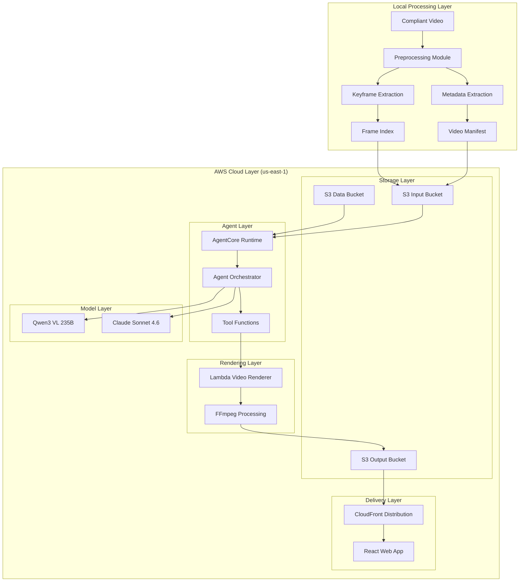
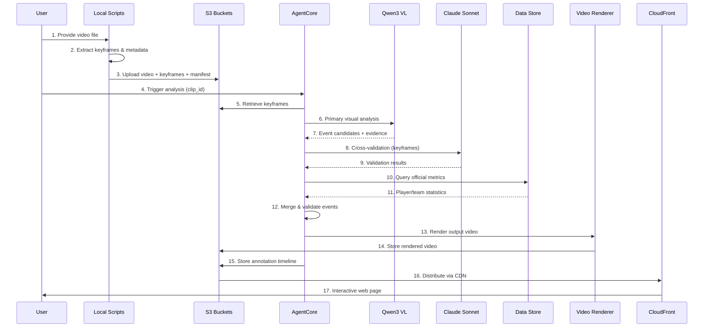
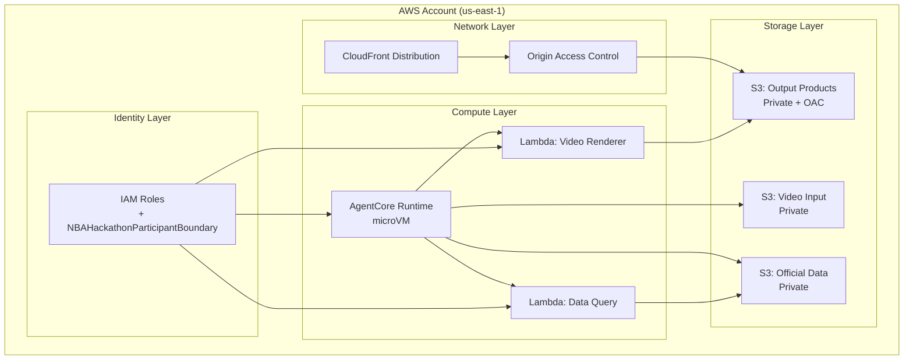

# Design Document: NBA Deep Court Visualization

## Overview

### Purpose

NBA「深度赛场」是一个 AWS × NBA 黑客松比赛项目，需要在限定时间内（2026年10月10日 20:00 硬截止）交付一个能够对 NBA 比赛视频进行智能分析的 AI Agent 系统。系统输入为 NBA 比赛视频，输出为带有数据可视化、战术解读和 AI 解说的成片及交互式 Web 页面。

### Core Value Proposition

让不懂篮球的观众也能通过视频标注理解比赛战术、球员行为和数据意义，模拟专业解说员的分析能力。

### Design Philosophy

1. **Local-First Processing**: 本地预处理减少云成本和时间
2. **Contract-Driven Validation**: 事件契约驱动的数据验证，防止模型幻觉
3. **Observation-Interpretation Separation**: 观察与推断分离，提高可信度
4. **No-Database Architecture**: 小数据用文件查询，避免过度工程
5. **Single Agent Orchestration**: 简化流程，确保可追溯

### Key Design Decisions

| Decision | Rationale | Trade-offs |
|----------|-----------|------------|
| Dual-model vision pipeline | Qwen3 VL 235B for primary analysis, Claude Sonnet 4.6 for cross-validation | Higher cost but better accuracy |
| File-based data storage | Simplicity for small dataset (~620 records), no RDS overhead | Not scalable for large datasets |
| Local preprocessing | Reduce cloud costs, faster iteration | Requires local Python environment |
| Single Agent architecture | Simpler debugging, clear audit trail | Limited parallelism |
| React + HTML5 Video | Standard web stack, good browser support | Not mobile-first |

---

## Architecture

### High-Level Architecture



### Component Interaction Flow



### Deployment Architecture



---

## Components and Interfaces

### 1. Video Preprocessing Module (Local)

**Purpose**: Extract keyframes and metadata from source videos before cloud upload.

**Interface**:

```typescript
interface VideoPreprocessor {
  // Input: path to video file
  // Output: preprocessing result with manifest
  process(input: VideoInput): Promise<PreprocessResult>;
}

interface VideoInput {
  filePath: string;
  clipId?: string; // Optional, auto-generated if not provided
}

interface PreprocessResult {
  clipId: string;
  manifest: VideoManifest;
  keyframes: KeyframeIndex;
  analysisCopy?: string; // Path to compressed copy if original > 25MB
}

interface VideoManifest {
  clipId: string;
  sourceSha256: string;
  sourcePath: string;
  fileSizeBytes: number;
  durationMs: number;
  resolution: { width: number; height: number };
  fps: number;
  codec: string;
  registeredAt: string; // ISO 8601
  compressedCopyPath?: string;
}
```

**Implementation Notes**:

- Use Python with `ffmpeg-python` or `ffprobe` for metadata extraction
- SHA-256 hash computed on entire file
- Keyframe extraction at 1 FPS or scene change detection
- Compression target: 10 MB for files > 25 MB
- Output: JSON manifest + PNG keyframes

**Error Handling**:

```python
class PreprocessingError(Exception):
    def __init__(self, reason: str, details: dict):
        self.reason = reason  # "UNREADABLE", "UNSUPPORTED_FORMAT", "COMPRESSION_FAILED"
        self.details = details
```

### 2. Agent Core (AgentCore Runtime)

**Purpose**: Orchestrate the analysis pipeline, coordinate model calls and tool invocations.

**Interface**:

```typescript
interface AgentOrchestrator {
  // Main entry point
  analyze(request: AnalysisRequest): Promise<AnalysisResult>;
  
  // Tool invocation
  invokeTool(tool: string, params: Record<string, any>): Promise<ToolResult>;
}

interface AnalysisRequest {
  clipId: string;
  options?: AnalysisOptions;
}

interface AnalysisOptions {
  skipCache?: boolean;
  enableCrossValidation?: boolean; // Default: true
  confidenceThreshold?: number; // Default: 0.70
}

interface AnalysisResult {
  clipId: string;
  events: DetectedEvent[];
  processingTimeMs: number;
  modelUsage: ModelUsageLog[];
  status: "SUCCESS" | "PARTIAL" | "FAILED";
  failureReason?: string;
}
```

**Execution Flow**:

1. Load VideoManifest from S3
2. Load KeyframeIndex from S3
3. For each keyframe batch:
   - Call Qwen3 VL for primary analysis
   - Record event candidates
4. For each candidate event:
   - Call Claude Sonnet for cross-validation
   - Compute agreement score
5. For validated events:
   - Query official data
   - Merge metrics into event
6. Generate AnnotationTimeline
7. Trigger Lambda renderer
8. Return AnalysisResult

**Tool Definitions**:

```json
{
  "tools": [
    {
      "name": "query_official_data",
      "description": "Query official NBA statistics for a player or event",
      "parameters": {
        "type": "object",
        "properties": {
          "query_type": { "type": "string", "enum": ["player", "game", "event"] },
          "player_id": { "type": "string" },
          "game_id": { "type": "string" },
          "event_id": { "type": "string" }
        },
        "required": ["query_type"]
      }
    },
    {
      "name": "render_video",
      "description": "Render annotated video with overlays",
      "parameters": {
        "type": "object",
        "properties": {
          "clip_id": { "type": "string" },
          "event_ids": { "type": "array", "items": { "type": "string" } },
          "output_format": { "type": "string", "enum": ["mp4", "webm"] }
        },
        "required": ["clip_id", "event_ids"]
      }
    }
  ]
}
```

### 3. Data Query Service

**Purpose**: Query official NBA statistics from CSV/JSON files with strict provenance tracking.

**Interface**:

```typescript
interface DataQueryService {
  queryPlayerSeasonMetrics(playerId: string): Promise<PlayerMetrics | null>;
  queryGameStats(gameId: string, playerId?: string): Promise<GameStats | null>;
  queryEventDetails(eventId: string): Promise<EventDetails | null>;
}

interface PlayerMetrics {
  playerId: string;
  playerName: string;
  shotDifficulty?: ShotDifficultyMetric;
  gravity?: GravityMetric;
  leverage?: LeverageMetric;
  sourceProvenance: DataProvenance[];
}

interface DataProvenance {
  field: string;
  value: any;
  sourceFile: string;
  recordId: string;
  queryTimestamp: string;
}
```

**Data Files**:

| File | Records | Key Fields |
|------|---------|------------|
| `shot-difficulty-2025-26-regular.csv` | 125 | playerId, avgShotDifficulty |
| `gravity-2025-26-regular.csv` | 234 | playerId, onBallGravity, offBallGravity |
| `leverage-2025-26-regular.csv` | 261 | playerId, leverageImpact |
| `candidate-player-shots.csv` | 41 | eventId, playerId, xfg_probability |

**Query Logic**:

```python
def query_player_metrics(player_id: str) -> dict | None:
    """
    Query season aggregate metrics for a player.
    Returns None if player not found.
    Does NOT fabricate missing values.
    """
    result = {
        "player_id": player_id,
        "shot_difficulty": None,
        "gravity": None,
        "leverage": None,
        "provenance": []
    }
    
    # Shot difficulty
    sd_record = find_in_csv("shot-difficulty-2025-26-regular.csv", player_id)
    if sd_record:
        result["shot_difficulty"] = sd_record["avgShotDifficulty"]
        result["provenance"].append({
            "field": "shot_difficulty",
            "source_file": "shot-difficulty-2025-26-regular.csv",
            "record_id": player_id
        })
    
    # Gravity
    grav_record = find_in_csv("gravity-2025-26-regular.csv", player_id)
    if grav_record:
        result["gravity"] = {
            "on_ball": grav_record["onBallGravity"],
            "off_ball": grav_record["offBallGravity"]
        }
        result["provenance"].append({
            "field": "gravity",
            "source_file": "gravity-2025-26-regular.csv",
            "record_id": player_id
        })
    
    return result
```

### 4. Video Rendering Module (Lambda)

**Purpose**: Render annotated video with overlays, subtitles, and data cards.

**Interface**:

```typescript
interface VideoRenderer {
  render(request: RenderRequest): Promise<RenderResult>;
}

interface RenderRequest {
  clipId: string;
  events: AnnotatedEvent[];
  style: RenderStyle;
  outputFormat: "mp4";
}

interface AnnotatedEvent {
  eventId: string;
  startMs: number;
  endMs: number;
  overlays: Overlay[];
}

interface Overlay {
  type: "text" | "marker" | "card";
  position: { x: number; y: number }; // Relative 0-1
  content: string;
  style: OverlayStyle;
}
```

**Rendering Constraints**:

- Maximum 1 explanation card per frame
- Maximum 2 highlight markers per frame
- Card types: "画面观察" (observation), "战术推断" (interpretation), "官方数据" (official data)
- AI-generated content must be labeled
- Preserve original audio track
- Output: H.264 MP4, AAC audio

**Implementation**:

- Lambda function with FFmpeg layer
- Memory: 2 GB
- Timeout: 5 minutes
- Input: S3 video + annotation JSON
- Output: S3 MP4

### 5. Web Presentation Layer (CloudFront + S3)

**Purpose**: Interactive web interface for video playback and event navigation.

**Interface**:

```typescript
interface WebInterface {
  loadClip(clipId: string): Promise<ClipData>;
  getEvents(clipId: string): Promise<Event[]>;
  jumpToEvent(eventId: string): void;
  toggleOverlays(visible: boolean): void;
}

interface ClipData {
  clipId: string;
  videoUrl: string;
  durationMs: number;
  events: EventMarker[];
}
```

**Features**:

- HTML5 Video player with custom controls
- Event markers on timeline
- Jump-to-event navigation
- Overlay visibility toggle
- Evidence card display

---

## Data Models

### Video Manifest

```json
{
  "$schema": "http://json-schema.org/draft-07/schema#",
  "type": "object",
  "required": ["clipId", "sourceSha256", "sourcePath", "fileSizeBytes", "durationMs", "resolution", "fps", "codec", "registeredAt"],
  "properties": {
    "clipId": { "type": "string", "pattern": "^train_[0-9]{3}$|^exam_[0-9]{3}$" },
    "sourceSha256": { "type": "string", "pattern": "^[a-f0-9]{64}$" },
    "sourcePath": { "type": "string" },
    "fileSizeBytes": { "type": "integer", "minimum": 0 },
    "durationMs": { "type": "integer", "minimum": 0 },
    "resolution": {
      "type": "object",
      "required": ["width", "height"],
      "properties": {
        "width": { "type": "integer", "minimum": 1 },
        "height": { "type": "integer", "minimum": 1 }
      }
    },
    "fps": { "type": "number", "minimum": 0 },
    "codec": { "type": "string" },
    "registeredAt": { "type": "string", "format": "date-time" },
    "compressedCopyPath": { "type": "string" },
    "gameId": { "type": "string" },
    "playerIds": { "type": "array", "items": { "type": "string" } }
  }
}
```

### Event Schema

```json
{
  "$schema": "http://json-schema.org/draft-07/schema#",
  "type": "object",
  "required": ["eventId", "eventType", "startMs", "endMs", "observation", "interpretation", "evidenceFrames", "confidence", "verificationStatus"],
  "properties": {
    "eventId": { "type": "string", "pattern": "^EVT-[0-9]{4}$" },
    "eventType": {
      "type": "string",
      "enum": ["shot", "pass", "drive", "screen", "defensive_action"]
    },
    "startMs": { "type": "integer", "minimum": 0 },
    "endMs": { "type": "integer", "minimum": 0 },
    "observation": { "type": "string" },
    "interpretation": { "type": "string" },
    "evidenceFrames": {
      "type": "array",
      "minItems": 1,
      "maxItems": 3,
      "items": {
        "type": "object",
        "required": ["timestampMs", "s3Key"],
        "properties": {
          "timestampMs": { "type": "integer" },
          "s3Key": { "type": "string" },
          "description": { "type": "string" }
        }
      }
    },
    "confidence": { "type": "number", "minimum": 0, "maximum": 1 },
    "verificationStatus": {
      "type": "string",
      "enum": ["verified", "unverified", "needs_review"]
    },
    "crossValidation": {
      "type": "object",
      "properties": {
        "primaryModel": { "type": "string" },
        "secondaryModel": { "type": "string" },
        "agreementScore": { "type": "number", "minimum": 0, "maximum": 1 },
        "discrepancies": { "type": "array", "items": { "type": "string" } }
      }
    },
    "playerId": { "type": "string" },
    "playerName": { "type": "string" },
    "teamId": { "type": "string" },
    "officialData": {
      "type": "object",
      "properties": {
        "xfgProbability": { "type": "number" },
        "shotDifficulty": { "type": "number" },
        "gravity": { "type": "number" },
        "leverage": { "type": "number" },
        "provenance": {
          "type": "array",
          "items": {
            "type": "object",
            "required": ["field", "sourceFile", "recordId", "queryTimestamp"],
            "properties": {
              "field": { "type": "string" },
              "value": { "type": ["number", "string", "null"] },
              "sourceFile": { "type": "string" },
              "recordId": { "type": "string" },
              "queryTimestamp": { "type": "string", "format": "date-time" }
            }
          }
        }
      }
    }
  }
}
```

### Annotation Timeline

```json
{
  "$schema": "http://json-schema.org/draft-07/schema#",
  "type": "object",
  "required": ["clipId", "version", "generatedAt", "events", "overlayTimeline"],
  "properties": {
    "clipId": { "type": "string" },
    "version": { "type": "string" },
    "generatedAt": { "type": "string", "format": "date-time" },
    "events": {
      "type": "array",
      "items": { "$ref": "#/definitions/Event" }
    },
    "overlayTimeline": {
      "type": "array",
      "items": {
        "type": "object",
        "required": ["timestampMs", "overlays"],
        "properties": {
          "timestampMs": { "type": "integer" },
          "overlays": {
            "type": "array",
            "maxItems": 3,
            "items": {
              "type": "object",
              "required": ["type", "content"],
              "properties": {
                "type": { "type": "string", "enum": ["observation", "interpretation", "official_data"] },
                "content": { "type": "string" },
                "position": {
                  "type": "object",
                  "properties": {
                    "x": { "type": "number", "minimum": 0, "maximum": 1 },
                    "y": { "type": "number", "minimum": 0, "maximum": 1 }
                  }
                }
              }
            }
          }
        }
      }
    }
  }
}
```

---

## Correctness Properties

*A property is a characteristic or behavior that should hold true across all valid executions of a system—essentially, a formal statement about what the system should do. Properties serve as the bridge between human-readable specifications and machine-verifiable correctness guarantees.*

### Property 1: Video Hash Integrity

*For any* video file processed by the system, the SHA-256 hash recorded in the manifest shall match the actual file hash, and shall remain unchanged after any processing operation.

**Validates: Requirements 1.1, 1.2**

### Property 2: Clip ID Uniqueness and Idempotency

*For any* video file, registering it multiple times shall return the same `clip_id`, and different videos shall receive different `clip_id`s.

**Validates: Requirements 1.3, 1.4**

### Property 3: Frame Timestamp Accuracy

*For any* video and any extracted frame, the frame's timestamp shall be within ±50ms of the expected timestamp based on the extraction interval and frame position.

**Validates: Requirements 2.1, 2.2**

### Property 4: Event Temporal Bounds

*For any* video and any detected event, `0 <= start_ms <= end_ms <= video_duration_ms`.

**Validates: Requirements 3.3**

### Property 5: Evidence Frame Cardinality

*For any* detected event, the number of evidence frames shall be between 1 and 3 inclusive.

**Validates: Requirements 3.4**

### Property 6: Observation-Interpretation Separation

*For any* event, both `observation` and `interpretation` fields shall exist and be non-empty strings with distinct labels.

**Validates: Requirements 3.5**

### Property 7: Confidence-Based Flagging

*For any* event with `confidence < 0.70`, the event shall have `verificationStatus = "needs_review"`.

**Validates: Requirements 3.6**

### Property 8: Data Query Provenance

*For any* displayed official metric, the response shall include `sourceFile`, `recordId`, and `queryTimestamp` in the provenance array.

**Validates: Requirements 4.7**

### Property 9: No Hallucinated Statistics

*For any* statistical value in a query response, the value shall exist in one of the source CSV files under `data/public-nba/20261009/`.

**Validates: Requirements 4.6**

### Property 10: Missing Data Graceful Degradation

*For any* query for unavailable data, the system shall return `null` for that field and include the placeholder text "官方数据未提供".

**Validates: Requirements 4.4**

### Property 11: Overlay Cardinality

*For any* frame in the rendered video, there shall be at most 1 explanation card and at most 2 highlight markers.

**Validates: Requirements 7.2**

### Property 12: Annotation Type Labeling

*For any* annotation overlay, the `type` field shall be one of: "画面观察" (observation), "战术推断" (interpretation), "官方数据" (official data).

**Validates: Requirements 7.3**

### Property 13: Video Aspect Ratio Preservation

*For any* rendered video, the output aspect ratio shall match the input video's aspect ratio.

**Validates: Requirements 7.1**

### Property 14: Query Response Time

*For any* valid data query, the response time shall be under 500 milliseconds.

**Validates: Requirements 4.1**

### Property 15: Large Video Compression

*For any* video file exceeding 25 MB, the system shall create a compressed analysis copy with size ≤ 10 MB, or extract keyframes at 1 FPS.

**Validates: Requirements 1.6**

---

## Error Handling

### Error Categories

```typescript
enum ErrorCategory {
  INPUT_ERROR = "INPUT_ERROR",       // Invalid input file
  PROCESSING_ERROR = "PROCESSING_ERROR", // Model or tool failure
  DATA_ERROR = "DATA_ERROR",         // Data query failure
  VALIDATION_ERROR = "VALIDATION_ERROR", // Constraint violation
  INFRASTRUCTURE_ERROR = "INFRASTRUCTURE_ERROR" // AWS service failure
}

interface SystemError {
  category: ErrorCategory;
  code: string;
  message: string;
  details: Record<string, any>;
  recoverable: boolean;
  retryable: boolean;
}
```

### Graceful Degradation Rules

| Failure Type | Degradation Behavior |
|--------------|---------------------|
| Model API failure | Return "unverified" status, preserve event candidates |
| Data query failure | Return `null` + "官方数据未提供" |
| Video-event alignment failure | Mark as "unverified", do not guess |
| Player identification failure | Display "未知球员" with tracking ID |
| Low confidence event | Flag for human review, still include |
| Rendering failure | Return error, preserve annotation timeline |

### Error Response Format

```json
{
  "success": false,
  "error": {
    "category": "DATA_ERROR",
    "code": "QUERY_FAILED",
    "message": "数据查询失败",
    "details": {
      "query_type": "player",
      "player_id": "1642843",
      "missing_fields": ["gravity"]
    },
    "recoverable": true,
    "retryable": false
  },
  "partial_result": {
    "player_id": "1642843",
    "shot_difficulty": 0.45,
    "gravity": null,
    "leverage": null
  }
}
```

---

## Testing Strategy

### Testing Approach

Given the nature of this system (multi-modal AI analysis with infrastructure deployment), we use a **hybrid testing strategy**:

| Test Type | Applicability | Coverage |
|-----------|---------------|----------|
| **Property-Based Tests** | Pure functions, data transformations, invariants | Properties 1-15 |
| **Integration Tests** | Model API calls, AWS service interactions | Event detection, data queries |
| **Smoke Tests** | Deployment, availability checks | CDK stack, CloudFront URL |
| **Example-Based Tests** | UI interactions, specific scenarios | Web interface |

### Property-Based Testing Details

**When PBT Applies**:
- Video metadata extraction (Properties 1, 15)
- Event temporal bounds (Property 4)
- Data provenance tracking (Properties 8, 9, 10)
- Overlay cardinality (Property 11)
- Query response time (Property 14)

**When PBT Does NOT Apply** (Use Integration Tests Instead):
- Event detection accuracy (depends on video content)
- Model cross-validation (depends on model behavior)
- Video-event alignment (depends on gameClock data availability)
- CloudFront URL availability (infrastructure check)

### Test Configuration

```python
# Property-based test configuration
from hypothesis import settings, Phase

# Default settings for all property tests
settings.register_profile("default", 
    max_examples=100,
    deadline=None,
    phases=[Phase.generate, Phase.target, Phase.shrink]
)

# CI profile with more examples
settings.register_profile("ci",
    max_examples=500,
    deadline=5000
)
```

---

## Deployment Configuration

### AWS Resources (us-east-1)

```yaml
# CDK Stack Configuration
Resources:
  # S3 Buckets
  VideoInputBucket:
    Type: AWS::S3::Bucket
    Properties:
      BucketName: nba-deep-court-input-${AWS::AccountId}
      AccessBlock: 
        BlockPublicAcls: true
        BlockPublicPolicy: true
        IgnorePublicAcls: true
        RestrictPublicBuckets: true
      
  OutputBucket:
    Type: AWS::S3::Bucket
    Properties:
      BucketName: nba-deep-court-output-${AWS::AccountId}
      AccessBlock: 
        BlockPublicAcls: true
        BlockPublicPolicy: true
        IgnorePublicAcls: true
        RestrictPublicBuckets: true

  # CloudFront Distribution
  CloudFrontDistribution:
    Type: AWS::CloudFront::Distribution
    Properties:
      DistributionConfig:
        Origins:
          - DomainName: !GetAtt OutputBucket.RegionalDomainName
            Id: S3Origin
            S3OriginConfig:
              OriginAccessIdentity: ''
        DefaultCacheBehavior:
          TargetOriginId: S3Origin
          ViewerProtocolPolicy: redirect-to-https
          CachePolicyId: 658327ea-f89d-4fab-a63d-7e88639e58f6
        PriceClass: PriceClass_100
        DefaultTTL: 86400
        Enabled: true

  # IAM Role with Competition Boundary
  AgentExecutionRole:
    Type: AWS::IAM::Role
    Properties:
      AssumeRolePolicyDocument:
        Version: '2012-10-17'
        Statement:
          - Effect: Allow
            Principal:
              Service: bedrock-agentcore.amazonaws.com
            Action: sts:AssumeRole
      PermissionsBoundary: arn:aws:iam::${AWS::AccountId}:policy/NBAHackathonParticipantBoundary
      ManagedPolicyArns:
        - arn:aws:iam::aws:policy/service-role/AmazonBedrockAgentCorePolicy
```

### Environment Variables

```bash
# AgentCore Runtime Environment
AWS_REGION=us-east-1
S3_INPUT_BUCKET=nba-deep-court-input-${ACCOUNT_ID}
S3_OUTPUT_BUCKET=nba-deep-court-output-${ACCOUNT_ID}
S3_DATA_BUCKET=nba-deep-court-data-${ACCOUNT_ID}

# Model Configuration
PRIMARY_MODEL_ID=qwen.qwen3-vl-235b-a22b
SECONDARY_MODEL_ID=global.anthropic.claude-sonnet-4-6
CONFIDENCE_THRESHOLD=0.70

# Performance Targets
MAX_PROCESSING_TIME_MS=600000  # 10 minutes
QUERY_TIMEOUT_MS=500

# Cost Control
BUDGET_WARNING_THRESHOLD_USD=80
BUDGET_HARD_LIMIT_USD=100
```

---

## Cost Estimation

### Model API Costs (Per Clip Analysis)

| Model | Input Token Budget | Output Token Budget | Unit Cost | Per Request |
|-------|-------------------|---------------------|-----------|-------------|
| Qwen3 VL 235B | 30,000 | 3,000 | $0.53/$2.66 per 1M | $0.02388 |
| Claude Sonnet 4.6 | 20,000 | 4,000 | $3.00/$15.00 per 1M | $0.12000 |
| **Per Clip (Dual Model)** | - | - | - | **$0.14388** |
| With 30% retry buffer | - | - | - | **$0.18704** |

### Infrastructure Costs (3-Day Competition)

| Service | Usage Estimate | Unit Cost | Total |
|---------|---------------|-----------|-------|
| AgentCore Runtime | 50 hours, 0.5 vCPU avg | $0.05/vCPU-hour | $1.25 |
| Lambda (Renderer) | 100 invocations, 2GB, 2min | $0.0000166667/GB-sec | $0.40 |
| S3 Storage | 2 GB output | $0.023/GB-month | $0.005 |
| S3 Requests | 10,000 requests | $0.0004/1000 | $0.004 |
| CloudFront Transfer | 50 GB | $0.12/GB (first 10TB) | $6.00 |
| CloudWatch Logs | 1 GB ingested | $0.50/GB | $0.50 |
| **Infrastructure Subtotal** | - | - | **$8.16** |

### Total Budget Scenarios

| Scenario | Model Calls | Model Cost | Infrastructure | Total |
|----------|-------------|------------|----------------|-------|
| Limited Debug | 100 rounds | $18.70 | $8.16 | **$27** |
| Recommended: Full Polish | 300 rounds + 30 Opus | $63.91 | $8.16 | **$72** |
| High Frequency | 1000 rounds + 100 Opus | $213.04 | $15.00 | **$228** |

**Budget Recommendation**: Reserve $100, monitor at $50 and $80 thresholds.

---

## Risk Mitigation

### Technical Risks

| Risk | Likelihood | Impact | Mitigation |
|------|------------|--------|------------|
| Model quota = 0 in competition account | Medium | Critical | Verify Portal access immediately; have fallback model IDs |
| Video-event alignment fails (missing gameClock) | High | High | Manual alignment with evidence documentation |
| CDK deployment exceeds time budget | Medium | High | Practice deployment; use minimal stack |
| Model hallucinates statistics | High | Critical | Strict data contract; null for unavailable; provenance tracking |
| CloudFront URL expires before judging | Low | Critical | Verify URL validity window; set appropriate TTL |

### Operational Risks

| Risk | Mitigation |
|------|------------|
| API costs exceed budget | Log all invocations; implement warning at 80% |
| Deadline missed | Prioritize P0 tasks; practice end-to-end flow |
| Test video doesn't represent exam video | Design for general basketball video patterns |

---

## File Structure

```
nba-deep-court/
├── agent/                    # AgentCore Runtime code
│   ├── orchestrator.py       # Main agent logic
│   ├── tools/                # Tool functions
│   │   ├── data_query.py
│   │   └── video_render.py
│   └── requirements.txt
│
├── lambda/                   # Lambda functions
│   ├── renderer/
│   │   ├── handler.py
│   │   └── ffmpeg_layer/
│   └── query/
│       └── handler.py
│
├── lib/                      # CDK Stack definitions
│   ├── stack.py
│   ├── constructs/
│   │   ├── storage.py
│   │   ├── agent.py
│   │   └── delivery.py
│   └── cdk.json
│
├── web/                      # React frontend
│   ├── src/
│   │   ├── components/
│   │   ├── hooks/
│   │   └── App.tsx
│   └── package.json
│
├── scripts/                  # Local processing scripts
│   ├── preprocess_video.py
│   ├── extract_keyframes.py
│   └── upload_to_s3.py
│
├── data/                     # Official data (CSV/JSON)
│   └── public-nba/20261009/
│
└── docs/                     # Documentation
    ├── architecture.md
    └── deployment.md
```

---

## Performance Targets

| Metric | Target | Measurement |
|--------|--------|-------------|
| 24s video end-to-end processing | ≤ 10 minutes | Processing log timestamps |
| Web initial load | ≤ 3 seconds | Browser dev tools |
| Data query response | ≤ 500 ms | Lambda execution duration |
| Model API response | ≤ 30 seconds | Bedrock API latency |
| Video rendering | ≤ 2 minutes | Lambda execution duration |

---

## Version History

| Version | Date | Author | Changes |
|---------|------|--------|---------|
| 1.0 | 2026-10-09 | Design Agent | Initial design document |

