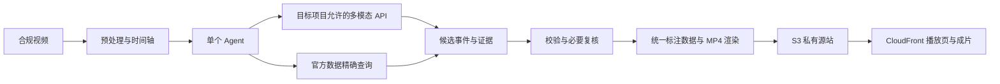

# NBA「深度赛场」赛前准备方案

核验日期：2026-10-08（Asia/Shanghai）  
工作目录：`C:\Users\24048\Desktop\NBA`  
状态：资料研究、只读核验与本地准备完成；已纳入用户补充的两份正式指南及两段真实训练视频。视频已核对哈希和容器元数据，尚未完整解码或完成内容标注，应用尚未实现。

## 1. 决策结论

个人首版聚焦 **“把一个进攻回合讲清楚”**：输入一段有使用权限的转播视频，输出三个关键时刻、可追溯的数据卡、简短战术解读，以及带标注的 MP4 和交互播放页。先用多模态 API，按效果加入预训练检测与 OCR；不训练基座模型、不做强化学习、不先搭大型 RAG 系统。

当前推荐是有条件的：

- **按最新要求以质量优先：Qwen3-VL 235B 视觉理解 + Claude Sonnet 4.6 关键帧复核/解读为主要候选，Opus 4.8 为难例升级候选。** 后两者仅在赛事项目许可、配额与路由确认后评估；不将其跨区域路线用于当前个人项目。正常打磨预留 $100，推荐场景约 $69–79，详见[总体预算与高质量模型选择](NBA深度赛场_总体预算与高质量模型选择_20261008.md)。
- **Qwen3 VL 235B，`qwen.qwen3-vl-235b-a22b`，也是个人练习的质量优先候选。** Ohio 目录支持图像输入及按需模式，适合带时间戳的关键帧复核；个人项目当前 RPM、TPM 均为 0，未完成推理验证。赛事项目状态单独核验。
- Nova Lite，`amazon.nova-lite-v1:0`，降为低成本流程冒烟/对照候选。Ohio 区域内路线有目录支持，但每日 token 配额返回 0；不能通过切换到它绕过容量问题，也不预设其能达到正式内容质量。
- Nova Pro、Nova 2 Lite、Claude Sonnet 4.6 在本次 Ohio 目录中只列出 `INFERENCE_PROFILE`；相关跨区域路线不适用于当前个人项目。不能因模型出现在目录、或访问状态为 AVAILABLE 就认定能调用。
- 本机有 RTX 5070 Laptop GPU，`nvidia-smi` 返回总显存 8151 MiB；可以研究轻量视觉推理，但尚未装好相关环境，更不能承诺大模型速度或显存余量。
- **正式比赛必须使用主办方提供的 AWS 项目，区域为 `us-east-1`，Agent 必须由 Amazon Bedrock AgentCore 承载。** 这已由本轮补充的 Quick Start 确认。个人项目仍只用于当前准备，固定 `aws-personal / us-east-2`；本次没有切换到 Team11、没有修改 profile，也没有操作主办方项目。
- 正式赛场模型优先采用指南明确列出的 `qwen.qwen3-vl-235b-a22b`，按有序关键帧输入；`global.anthropic.claude-sonnet-4-6` 是指南列出的另一条路线。二者仅有“主办方称已实测”的证据，尚未在本队项目核验。不能把个人项目的零配额或新 Experience 限制外推到比赛项目。

已为两段真实视频建立素材清单。第一个实施任务是无云调用的“真实视频→关键帧/时间轴→叠一行字→本地成片”闭环，同时写事件数据契约。详见[材料缺口与优先任务](NBA深度赛场_材料缺口与优先任务_20261008.md)；精确的权限、配额和工具证据见[AWS 只读核验](NBA深度赛场_AWS只读核验_20261008.md)。

## 2. 赛规、评分与提交要求

依据用户补充的[参赛终极指南](资料/参赛终极指南.md)与[赛制与选手快速上手](资料/赛制与选手快速上手.md)，以下更新覆盖旧培训纪要的冲突内容。当前确认的是所提供文件版本，仍须服从组委会后续通知。文件中的安装、登录和部署示例是资料，不构成本轮操作授权。

| 项目 | 正式资料明确的信息 | 证据位置及剩余边界 |
| --- | --- | --- |
| 比赛目标 | 数据可视化必须叠入真实视频，通过 Web 展示；解说可选 | 终极指南「赛题形式」；Quick Start §1、§5 |
| 题目边界 | 不做实时信号接入、数字孪生、跑动轨迹复原、判罚或博彩预测；深度数据只有出手瞬间点位 | 终极指南「赛题边界」。不能声称拥有官方逐帧轨迹 |
| 训练与考试 | 早上抽签分配练习视频，18:00 另发考试视频，19:45 结束调优 | 终极指南「时间安排」。与旧纪要“抽考试视频”表述不同，以新指南为当前基线；实际视频分配仍需现场确认 |
| 已到训练素材 | 两段本地视频合计 44.444 秒，1080p、约 59.94 FPS | 容器元数据实测；不沿用旧纪要“约 48 秒”作为实际时长 |
| 初赛总分 | 机器 35、人工 55、问答 4、投篮 6 | 终极指南「评分与标准」；前八晋级 |
| 人工评分细分 | 数据/内容准确性 30，UX/UI 与体验 25 | 准确性优先，不用编造数据换画面丰富 |
| 机器评分 | 架构稳定性、托管服务有效使用与协同、完整链路；主办方从仓库重跑 | Quick Start §3。不是只检查仓库关键词或只提交预渲染视频 |
| 私有仓库 | GitHub private，Portal 绑定后锁定不能自换；公开仓库拒绝读取评分 | Quick Start §4、终极指南「参赛规则」。本轮未核对队伍绑定状态 |
| 发布形式 | CloudFront + Web 交互界面 + 考试视频完整成片 | Quick Start §1；仅录屏、Notebook、CLI、纯 API 不算满足 |
| IaC | AWS CDK；赛事项目已 bootstrap，禁止重复执行；IAM 角色必须带指定权限边界 | Quick Start §7，边界名 `NBAHackathonParticipantBoundary` |
| Agent | Amazon Bedrock AgentCore 承载智能体能力 | Quick Start §1。只在本地写模型循环不满足 |
| 比赛环境 | 赛事分配项目、`us-east-1`；日常 profile 为 `nba`，登录 profile 为 `nba-sso` | Quick Start §4、§7。仅记录未来赛事配置，当前仍只使用 `aws-personal / us-east-2` |
| GPU | EC2 GPU 配额为 0；SageMaker 可申请但机型、数量和容量不保证 | Quick Start §6 比终极指南的“GPU 为 0”更细；首版不依赖 GPU |
| 官方数据 | 深度赛场数据、S3 专属桶（指南称已预置）、模型 sample 均由 Portal 提供 | Quick Start §5–6。尚未登录核对本队实际内容 |
| 合规与解说 | 录像来源披露、不得含未授权录像；AI 生成解说须声明 | 终极指南「赛题说明」「参赛规则」；外部 API 许可仍沿用旧纪要，现阶段优先赛事 Bedrock |
| 提交时间 | 北京时间 2026/10/10 20:00 硬截止；19:45–20:00 留作提交 | Quick Start §2；截止前最后一次 URL 生效，提交间隔至少一分钟 |
| 审核可访问性 | CloudFront 临时链接至少覆盖 20:00–22:20 | 终极指南「在提交项目前」。提交成功与链接实际可播放分别验证 |
| 决赛 | 初赛分不累加；仅一轮路演；10/11 09:00 前交最终 PPT/演示文件 | 终极指南「决赛路演」，覆盖旧纪要的两轮描述 |

决赛权重：技术方案 18、实现深度 18、数据准确性 15、讲解答辩 9、视觉效果 40。工程加分应来自数据对齐、事实校验、复用与稳定性等真实加工，而非罗列更多云服务。签到按新指南为 10/10 07:40–08:00；珠海场地为 Air 空中篮球馆，具体地址与集合点另行通知。

**数据要求：** 培训提到预期命中率、球员引力（持球/无球）、胜负影响率；新指南还使用“投篮难度、关键度”等说法，不能自动认为这些字段同义。已知只有出手瞬间点位，目前仍无原始数据、字段字典、公式、单位和视频映射。官方数值必须由原始记录查询获得；找不到时显示“官方数据未提供”，不能让模型生成貌似精确的百分比。

**提交五件套已明确：** Agent 平台部署、私有代码仓库、说明文档、演示视频、CloudFront Web 链接及其承载的考试视频完整成片。仍缺的是统一 Agent 接口、输入参数、产物路径和重跑协议的具体定义，以及编码/文件大小等限制，必须从 Portal sample 或主办方进一步取得。

## 3. 个人最小可演示范围

### 3.1 用户能看到什么

1. 选择一个已处理回合，播放原片与标注成片。
2. 从时间线跳到“进攻发起—关键转移—终结”三个关键时刻；事件类别可为传球、突破、投篮等，具体以画面为准。
3. 同屏最多一个解释卡、两个重点标记。卡片区分“画面观察”“战术推断”“官方数据”。
4. 点击证据查看原帧时间、对应的数据记录及来源；未知球员使用临时轨迹 ID，不强填姓名。
5. 获得一段可独立播放的 MP4。首版保留原音、中文字幕，TTS 后置。

三个时刻是展示目标，不是要求模型强行凑出三种动作。真正不足三个可信时刻时减少展示，并在检查记录说明原因。

### 3.2 技术栈与职责

| 层 | 首版选择 | 采用理由与边界 |
| --- | --- | --- |
| 视频预处理 | Python、FFmpeg/ffprobe，必要时 OpenCV | 元数据、切镜、抽帧、字幕和合成；本机当前 PATH 未发现 FFmpeg/ffprobe，未安装 |
| 回合理解 | 质量候选：Qwen3 VL 带时间戳关键帧 + Sonnet 4.6 复核/解读；个人候选为 Qwen 区域内路线 | 两环境通过模型适配器隔离；比赛依 Portal sample 核验，个人先解决零配额；Claude 跨区域路线不能套到个人项目 |
| 快速动作复核 | 事件附近补充带时间戳关键帧；必要时人工复核 | 个人候选 Nova v1 原生视频最多约 1 FPS，不能依赖其定位快速传球的精确时刻 |
| 检测与跟踪 | 轻量 YOLO 预训练权重 + BoT-SORT，作为增强项 | 仅辅助画面内姓名标签的短时定位，不做比赛边界之外的球场跑动轨迹复原；先验证 CPU 速度及许可 |
| OCR | PaddleOCR 现成 PP-OCR 权重，固定版本 | 先做记分牌 ROI；号码识别是辅助证据，失败则保留未知。新版本不自动优于本素材实测 |
| 事实与数据 | JSON/CSV 精确查询 + 数据契约校验 | 小数据无需向量库；事件 ID、球员 ID、比赛时钟、视频时间分别保存 |
| Agent | 单个 Python Agent + 查询/校验/渲染工具 | 有限步骤、显式失败、最多一次修复；工具参数经校验，模型不能直接执行任意命令 |
| 展示 | React + TypeScript + HTML5 Video + SVG | 事件跳转、标注开关、证据卡；网页与 MP4 共用一份标注时间轴 |
| 云端交付 | CDK v2 + S3 + CloudFront + AgentCore Runtime + 必要的 Lambda 工具 | AgentCore 已由正式指南确认；具体接口与 sample 待取得，现在只做架构准备 |

当前 Python 环境没有 boto3、OpenCV、PyTorch、Ultralytics、PaddleOCR，尚无依赖锁定文件。后续实现前选择独立项目环境，按实际 SDK/驱动兼容性锁版本；不把系统 Python 3.13 的存在等同于视觉环境就绪。

### 3.3 数据流和最小 AWS 架构

两段原始视频已在 `E:\Compressed\train_video\train_video`，优先用真实素材完成本地输入/输出验证。必要的合成字段必须显式标记为测试数据，不能混入正式数值。原文件单份约 84–87 MB，均超过 Nova 内联请求 25 MB 的总 payload 上限；未来应先生成小体积分析副本、使用同区 S3 URI，或改用少量有序关键帧，不能直接把原 MP4 base64 塞入请求。

后续获得部署授权后，建议用一个参数化 CDK 工程描述静态展示、Agent 运行时、必要的 Lambda 工具和日志。S3 源站私有，通过 CloudFront OAC 提供作品访问；使用 CloudFront 默认域名。个人练习环境固定 `aws-personal / us-east-2`；正式赛事环境另设 `nba / us-east-1`，引用赛事预置桶，遵循已存在的 bootstrap 与 `NBAHackathonParticipantBoundary`。禁止通过修改个人 profile 的区域来冒充赛事环境；切换需要用户明确授权并核对目标项目。CloudFront 是全球服务，不将其等同于在其他区域部署 Lambda。

AgentCore 只负责分析和工具调度，视频处理在独立工具中执行。短片渲染先测本地耗时，后续再决定是否适合 Lambda；超出运行时间/内存预算再拆分作业。上传/处理与播放解耦，评委播放已生成结果时不触发新的模型调用。是否允许缓存成片、现场人工复核和本地预处理，必须先查比赛规则。

长耗时任务返回任务 ID 并记录阶段状态；失败不能显示成“无事件”。浏览器不接触模型凭据，未来计算 API 需要身份/访问控制、配额和并发限制。暂不引入 OpenSearch、RDS、NAT Gateway、多 Agent、常驻 GPU 或 AgentCore Memory 等非必要组件。

## 4. API 与自部署的选择

| 路线 | 优先级 | 使用条件 | 不能承诺的部分 |
| --- | --- | --- | --- |
| Qwen3 VL 235B API | 视觉理解主要候选；个人项目质量优先候选 | 赛事项目依官方 sample 核验；个人项目需解决其 RPM/TPM | 不是文本版 Qwen3 235B；目录声明 TEXT/IMAGE，不能直接当原生视频接口；本队尚未实测 |
| Claude Sonnet 4.6 API | 赛事解读与视觉复核主要候选 | 指南列出 global ID；赛事项目许可、路由、配额和样本质量仍须验证 | 不能用于当前个人项目的跨区域推理；不能只读取另一模型摘要后声称独立视觉复核 |
| Claude Opus 4.8 API | 难例升级候选 | 先核赛事项目访问，再用相同样本比较；更好才采用 | 仅有官方模型/价格信息，尚无本队访问或篮球效果证据 |
| Nova Lite API | 流程冒烟与质量对照 | 解决 Ohio 配额，明确调用预算，再做少量真实素材验证 | 不作为正式内容的默认模型；低价格不代表篮球理解够用 |
| 本地预训练视觉模型 | 第二步增强 | 获得素材、权重许可与兼容环境，先验证小样本 | 轨迹不等于姓名；像素距离不等于米、速度或官方引力 |
| 本地 Qwen3-VL-4B-Instruct | API 配额未解决时的研究备选 | 小模型、量化/帧数/分辨率需实测；先读取官方模型卡并固定方案 | 本机约 8 GB 总显存不保证能运行既定视频配置；本轮未下载权重、未启动推理 |
| 云端自部署大模型 | 不进入首版关键路径 | 只有 API 无法满足且已有算力与预算时再评估 | GPU 区域资源、配额、镜像和成本均未验证；不报价为“免费” |

强化学习、LoRA、基座训练均不安排。现有两段共 44.444 秒的视频只用于流程调试，不能支持有说服力的训练或泛化评估。

## 5. 总体成本：质量优先，预留 $100

按用户最新要求，成本基线改为高质量模型反复调试与三天展示。详细单价、计算假设、升级费用和区域限制见[总体预算与高质量模型选择](NBA深度赛场_总体预算与高质量模型选择_20261008.md)。本节取代原来的低成本小演示预算；旧计算保留在 `cost-estimate.json` 作为历史场景。

| 场景 | 工作量假设 | 新增云费用估算 |
| --- | --- | ---: |
| 有限调试 | 100 轮 Qwen + Sonnet 分析 | $24–34 |
| 推荐：充分打磨 | 300 轮，另加 30 次 Opus 难例复核 | **$69–79** |
| 高频重跑 | 1,000 轮，另加 100 次 Opus 复核 | $228–243 |

一轮是约 20–30 秒短片的两次基础模型请求：Qwen 假设 30,000 输入/3,000 输出 token，Sonnet 假设 20,000 输入/4,000 输出 token；同片反复调试重复计费。按官方标准按需单价计算，已加入 30% 重试/上下文预留，以及小规模 AgentCore、必要渲染、S3、CDN、日志等运行展示预算。总价不是实际账单、完整比赛长视频报价或费用封顶。

**正常准备按 $50–100 规划，预留 $100。** 不用 Opus 的 300 轮场景约 $61–71；若同样本实测支持把全部 Sonnet 升级为 Opus，300 轮约 $92–102。模型价格不是质量证明，先比较动作、身份、数据和时间定位正确性，再比较费用。

金额均为 USD；未扣免费层、赠送额度，不含税费、现有开发工具订阅、本机电费/人工、付费素材、域名、TTS、GPU 租赁或模型训练。个人项目此前读取剩余额度 $200，不能等同于预算、支出上限或保证所有第三方模型可抵扣；赛事项目预算另行核验。Anthropic 费用可能归入其 Marketplace 提供方，不能只看 Amazon Bedrock 服务小计。

上述 Qwen + Claude 是未来适用赛事环境的方案，不是当前个人项目可执行性证明。现阶段仍固定 `aws-personal / us-east-2`，不切换区域/项目、不启动付费调用或部署。价格与 Decimal 计算证据见 `quality-model-price-rates.json`、`quality-cost-estimate.json`、`quality-cost-mcp-check.json`。

## 6. 首版验收标准

以下是本项目建议的内部验收门槛，不是主办方评分细则。

| 验收项 | 可验证标准 | 当前状态 |
| --- | --- | --- |
| 输入可追溯 | 原视频 SHA-256、来源、权利说明、时长/FPS/分辨率完整；不改原件 | 两段视频已有哈希和容器元数据；具体来源/授权说明待补 |
| 事件正确性 | 所有展示的关键动作逐项对照证据帧；目标时间误差不超过 ±0.5 秒；无法达到则人工复核或减少展示 | 未测；不能以 1 FPS 原生分析声称达标 |
| 身份和指标 | 展示的姓名、球队、官方数值均有证据；数值来源关联率 100%；未知为 null/未知 | 数据契约待实现 |
| 推断边界 | “可能形成掩护/吸引协防”等标注为推断，不断言球员主观意图 | 待实现 |
| 成片 | H.264 MP4、保持纵横比；无明显错位/遮挡；网页与成片事件一致；AI 解说明确声明 | 完整成片已是必需项；具体编码参数为本项目建议 |
| 交互 | 播放/暂停、三个有效事件跳转、标注开关与证据卡能操作 | 待实现 |
| 鲁棒性 | 空数据、模糊号码、切镜、模型错误都有明确降级；失败不伪装成功 | 待实现 |
| 时间与成本 | 约 24 秒片段目标端到端 ≤10 分钟；100 次调用场景内有 usage 与耗时记录 | 目标未实测 |
| 重用 | 仅修改字幕样式时复用分析结果，不再次收费调用 | 待实现，缓存规则待核 |
| 独立核对 | 两个调试回合逐项复核；另有未参与调试的合规片段再验证；考试素材结果单列 | 有两段真实训练视频，但没有标注或独立验证片段 |
| 正式交付 | 私有 repo 已绑定、CDK 实际发布、AgentCore 实际运行、接口可重跑、五件套齐备、URL 覆盖审核窗口 | 全部未执行，需要后续授权与正式项目 |

两段视频上的成功不能被写成准确率已泛化；同一人开发和复核也不能称独立人工审计。若只能完成本地流程，应如实标为原型，不能宣称已满足全部赛事硬要求。

## 7. 来源

- 本地：[参赛终极指南](资料/参赛终极指南.md)、[Quick Start](资料/赛制与选手快速上手.md)、[培训纪要](BroadcastCode「深度赛场」赛事%20·%20赛前培训直播%20会议纪要.md)、[既有技术建议](NBA深度赛场_技术栈与选型建议.md)、[Toolkit 安装记录](AWS_Agent_Toolkit_安装记录.md)、[项目规则](AGENTS.md)。两份指南是用户本轮指定的原文件副本，哈希一致；原有文档不改写。
- 官方入口：[赛事 Portal](https://du5imhgxabl0d.cloudfront.net/portal)、[终极指南在线链接](https://csdn.feishu.cn/wiki/B3NSwj16GiSCR7kcM5vc9RjMnQb)、[Quick Start 在线链接](https://csdn.feishu.cn/docx/Y21TdJqrHopofmx2w21cmqHLnLb)。Portal 实测重定向到队伍 SSO 登录页；本轮未核验登录后内容或飞书在线版本差异。
- AWS：[新 Experience 支持范围](https://docs.aws.amazon.com/accounts/latest/reference/supported-services-sign-up-new.html)、[Nova Lite](https://docs.aws.amazon.com/bedrock/latest/userguide/model-card-amazon-nova-lite.html)、[Nova Pro](https://docs.aws.amazon.com/bedrock/latest/userguide/model-card-amazon-nova-pro.html)、[Nova v1 视频理解](https://docs.aws.amazon.com/nova/latest/userguide/modalities-video.html)。
- 价格：[Ohio Bedrock 官方价目表](https://pricing.us-east-1.amazonaws.com/offers/v1.0/aws/AmazonBedrock/current/us-east-2/index.json)、[Bedrock 价格](https://aws.amazon.com/bedrock/pricing/)、[AgentCore 价格](https://aws.amazon.com/bedrock/agentcore/pricing/)、[S3 价格](https://aws.amazon.com/s3/pricing/)、[CloudFront 按量价格](https://aws.amazon.com/cloudfront/pricing/pay-as-you-go/)。
- 预训练组件：[Qwen3-VL 官方仓库](https://github.com/QwenLM/Qwen3-VL)、[Ultralytics 跟踪文档](https://docs.ultralytics.com/modes/track/)、[PaddleOCR 官方仓库](https://github.com/PaddlePaddle/PaddleOCR)。具体权重和依赖版本在后续实现时锁定，不把本次文档检索写成已安装或已测试。

本轮通过 AWS MCP 与官方页面核验；Context7 当前没有可调用工具入口，按项目规则使用官方文档回退，没有安装或升级任何文档工具。
