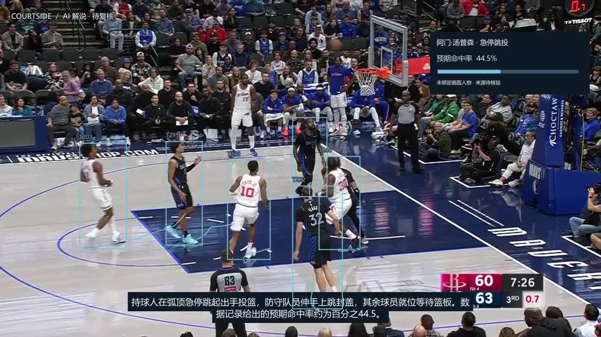
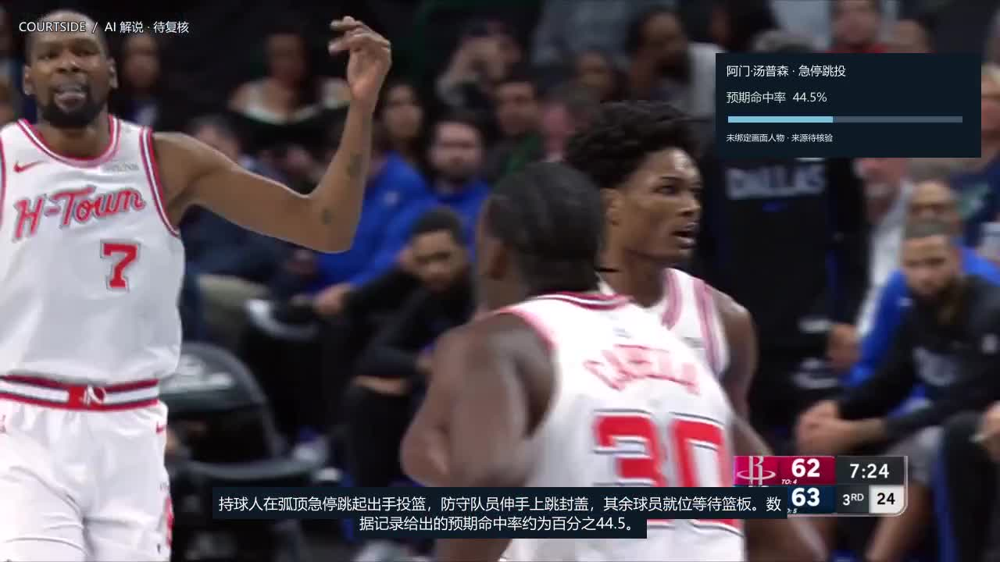
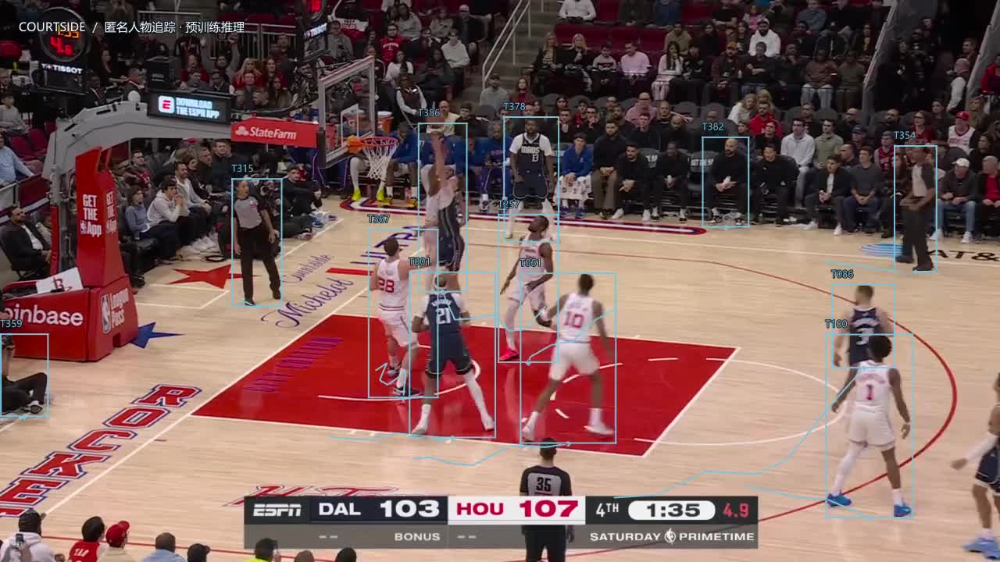

# 本地人物追踪与成片验证 · 2026-10-10

本次完成 P0/P1 工程实现与本地实际运行，未新增 AWS 模型调用、云资源、训练或赛事评测。本记录形成时源码尚未提交；后续随工具和小型证据纳入仓库，原验证数据保持不变。该轮模型/配置：YOLO11m、Ultralytics 8.4.174、BoT-SORT / sparseOptFlow、ReID 关闭，960 推理尺寸、最多 60 fps、2 个实际 Torch 推理线程。权重 SHA-256 见 [model-lock.json](../../vision/model-lock.json)。

## 已完成的实际证据

- **真实视频定位**：两段源片均已输出匿名人物框、镜头内 ID、近 0.8 秒画面轨迹、独立预览 MP4 和 JSONL。早期全画面检测把观众纳入，已增加浅色/木地板区域筛选、人物遮挡区域移除和边缘排除；裁判/场边人员仍未可靠分类，不把“有框”当作球员识别通过。
- **切镜修正**：原 0.38 像素阈值漏掉阿门 21.287933 秒、弗拉格 0.066733 秒的真实硬切。逐帧诊断后改为像素 0.22 + 直方图 0.25；两个硬切回归通过，弗拉格 16.5165 秒的球馆闪光不误判。这个结果不证明其它视频的切镜召回率。
- **Web 完整作品**：任务 `456ea04b-0c0f-48b0-b39a-3e65e4b57f6d`，注册素材 `38172313-7741-4c53-ba9b-e258af2519c3`，显式复用已完成 Sonnet 解说 `4cd247e2-6a4f-4b2c-aae1-151f69e41d63`。输入视频哈希、数据、时长一致；重新提取的证据帧哈希/时间与父任务一致。保留 provider=bedrock、needs_review，不把离线配置下的追踪复测称为新 AI 分析。
- **浏览器检查**：1280×720 视频播放、音轨解码、解说定位、44.5% 独立事件卡、轨迹下载与哈希、HTTP Range、旧 v1 作品、刷新不重跑全部通过；无页面脚本错误。日志、ASS 和私有路径不可下载。见 [web-report.json](web-report.json)。音轨解码/混音成功不替代完整人工听审。
- **本地文件复查**：当前校验器重新验证 manifest / rows，旧框在切镜处终止，MP4 哈希一致且全片解码成功，见 [artifact-checks.json](artifact-checks.json)。模型调用、输入/输出 tokens、估算新增模型费均为 0。复用不改进原解说中的语义错例；“弧顶”等描述仍需结合画面复核。
- **独立标注工具**：各 30 帧原画面核对页，不预填检测框；支持清晰/遮挡、拖框、撤销、逐帧确认、JSON 导出。工具交互通过，原参考 JSON 均 reviewed=false，见 [review-tool-report.json](review-tool-report.json)。没有产生真实精确率或召回率。

截图只验证可见标注与切镜行为，不作为独立框标注真值。射手腾空、边线附近漏框等问题仍存在。

## 性能与版本边界

| 本机运行 | 追踪墙钟 / CPU 秒 | Python RSS | 状态与用途 |
| --- | ---: | ---: | --- |
| 阿门 22.89 秒，首个限线程 P1 | 339.265 / 668.422 | 776,843,264 B | 实际 Torch=2；初始切镜阈值，不作为最终切镜验收 |
| 阿门 22.89 秒，修正切镜 P1 | 502.958 / 983.469 | 776,318,976 B | 686 个处理帧，638 帧有纳入人物；2 个镜头，87 条匿名轨迹；[最终 manifest](amen-tracking-manifest.json) |
| 弗拉格 21.55 秒，最终 P0 | 568.334 / 1116.641 | 776,536,064 B | 646 个处理帧、644 帧有纳入人物；2 个镜头、92 条匿名轨迹；[manifest](flagg-tracking-manifest.json)，[产物检查](flagg-artifact-checks.json) |

阿门视觉 JSONL 合计 7,115,407 B，视觉工具记录的输入+权重+流式文件峰值 64,107,487 B；最终任务产物目录 55,625,681 B。前者不包括 venv、字体、语音和编码阶段，后者不是整任务磁盘峰值。此前约 8 个线程的较快记录没有兑现配置，不可作为 2 vCPU 云端性能。墙钟波动较大；以上是 Windows 本机结果，不是 AgentCore / ARM64 基准。

当前速度未达到“60 秒片 8 分钟”的规划门槛。长视频分段、全流程临时空间峰值、Linux 音轨/字体和 2 GB ARM64 镜像尚未验证，不能据此宣称可部署。

弗拉格最终预览在 `.local/tracking-preview/artifacts/5c58901a-ace9-42b8-b135-f9da2df0a8d9/tracking-preview.mp4`，SHA-256 `13a904c86d34e6f916cbc883960a28b8005031b177d42fc608300fc1ccea7672`；本次 2 线程检查、当前工具哈希、逐帧曝光、切镜边界及全片解码均通过。视觉 JSONL 合计 6,815,006 B，输入/权重/流式文件峰值 58,835,979 B，同样不含渲染/venv。

最终阿门作品 `film.mp4` SHA-256：`d286e7732705efe7f5e428936a75f6f7e6ddd1dda74512d008cadabdea3a2be3`。本地 CFR 阿门产物产生于逐帧曝光字段补充前，使用兼容的平均帧率曝光；新工具已保存解码帧时长，VFR 规则和实际解码测试另外通过。工具/config 哈希分别记录，历史产物不重新标成当前工具版本。

## 自动检查与范围

39 项 Node 行为测试通过，[node-tests.txt](node-tests.txt)；前后端 TypeScript 检查及 Vite 构建通过，[build.txt](build.txt)；11 项 Python 检查通过，[python-tests.txt](python-tests.txt)。覆盖严格 v2 / v1 兼容、收费前失败、证据帧复用、防伪身份/非法时间坐标、切镜/缺口短轨迹、VFR 曝光，以及真实 SAR+90°旋转与 FFmpeg 显示方向比较。Python 中的 100% 指标是合成标注算法测试，**不代表 NBA 视频精度**。

本次仅验证功能、数据、时间和产物，没有改 CSS、检查布局或手机端。代码检查以请求 → 固定本地工具 → 校验 → 渲染 → 下载边界为范围；未接受上传命令、模型路径或外部视频 URL，未开放日志/配置，未把空身份随机绑定数据。没有进行全仓安全审计。

## 本机作品与下一步

完整作品位于 `.local/agent/artifacts/456ea04b-0c0f-48b0-b39a-3e65e4b57f6d/film.mp4`，可在 `http://127.0.0.1:4173/` 的运行记录恢复。MP4、权重、上传视频和任务目录仍在 `.local/`，不混入源码提交。

第一项：打开 `.local/tracking-quality/amen-final/review.html` 与 `.local/tracking-quality/flagg-final/review.html`，人工标注 30 帧中的全部可见场内球员，再按 [工具说明](../../vision/README.md)评估；另外按关键连续段统计 ID 切换与遮挡丢失。当前 87 / 92 条轨迹提示碎片存在，不能当成稳定十人跟踪。

两段核对页各含 30 张独立原帧（包括切镜邻域），当前 0 帧已核对、0 个真值框，见 [annotation-status.json](annotation-status.json)。不能把 UI 导出测试文件或 Python 合成标注用于 NBA 精度验收。

随后按错例改进场地/裁判分类与关联，取得一段未收录视频做泛化验收，再推进 P2 身份/事件绑定。P3 仍需独立验证与对应云部署授权。当前所有 player_id / court_xy_m 留空，关联文件为空，选中轨迹高亮和失败任务通用重渲染未实现。
